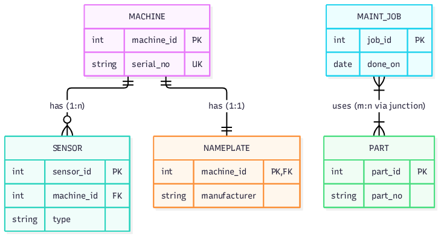
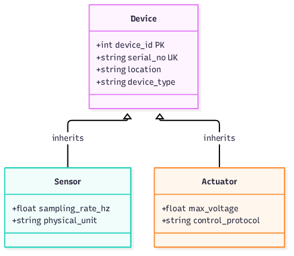
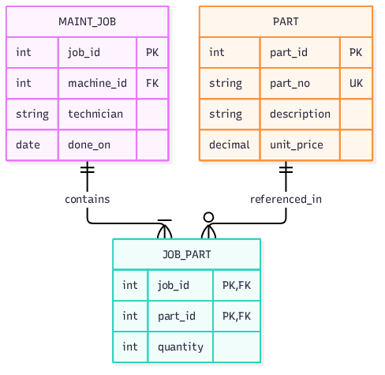
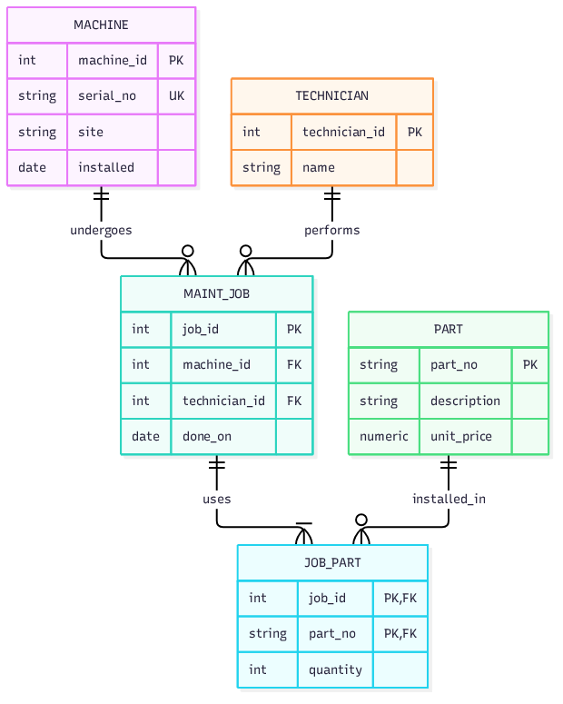
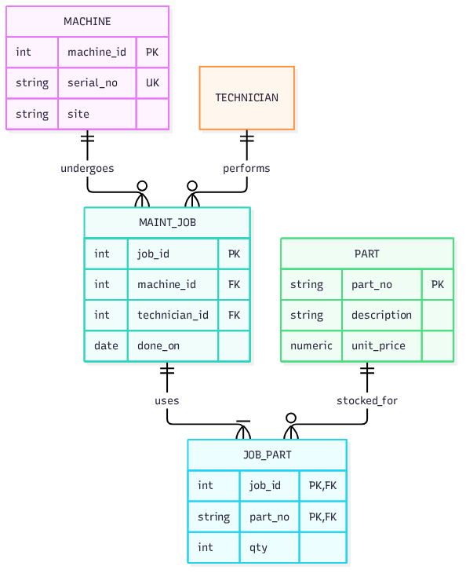
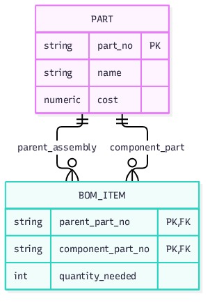
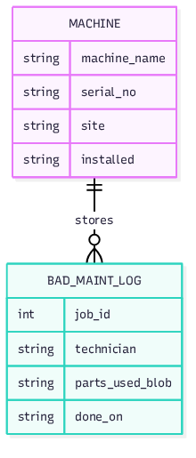

# Module 2 — Data Contracts & Legacy Schemas

**Portfolio of:** Trainn  
**Class:** HSBI Database Class  

In this module, instead of designing a database from scratch, I worked through an undocumented legacy maintenance database from an injection-molding company (Kortmann Kunststofftechnik GmbH). The goal was to audit the flawed schema, prove what was broken with SQL queries, rebuild the ER diagram, and write a solid data contract in Python (Pydantic + SQLAlchemy) to prevent bad data from getting in.

---

## Pod Study: Key Concepts & Pointers

Here is my breakdown of the core modeling concepts from the self-study:

- **Entity**: An independent physical or logical thing we store data about (`Machine`, `Part`, `Technician`). In SQLite, this becomes a table.
- **Attribute**: A property describing an entity (`serial_no`, `site`, `unit_price`). In SQLite, these are columns.
- **Relationship**: How entities connect to each other (`Technician` fixes `Machine`).
- **Cardinality**: The count bounds on a relationship:
  - **1 : 1**: One machine has one nameplate (foreign key on either side with `UNIQUE`).
  - **1 : n**: One machine has many sensor logs (foreign key on the "many" side).
  - **m : n**: Maintenance jobs use many parts, and parts belong to many jobs. This **requires a junction table** (`job_part`).
- **Keys (Natural vs. Surrogate)**:
  - *Natural Key*: Real-world identifiers like machine serial numbers (`SN-88120`). They can change or have weird formatting.
  - *Surrogate Key*: Auto-incrementing integers (`INTEGER PRIMARY KEY`). Simple, fast for joins, and never change.
  - *Best practice*: Use surrogate keys as the primary key, but put a `UNIQUE` constraint on the natural key so duplicates can't sneak in.

### Pointers & References

- [Wikipedia: Entity–relationship model](https://en.wikipedia.org/wiki/Entity%E2%80%93relationship_model) — Definitions of entities, attributes, and relationships.
- [Wikipedia: Crow's-foot / IE notation](https://en.wikipedia.org/wiki/Entity%E2%80%93relationship_model#Cardinality_and_ordinality) — How to read relationship ends (`||` = exactly one, `|{` = one or more, `o{` = zero or more).
  
- [Wikipedia: Enhanced entity–relationship model](https://en.wikipedia.org/wiki/Enhanced_entity%E2%80%93relationship_model) — Generalization and inheritance (e.g. Device -> Sensor / Actuator).
  
- [Wikipedia: Natural key](https://en.wikipedia.org/wiki/Natural_key) vs [Wikipedia: Surrogate key](https://en.wikipedia.org/wiki/Surrogate_key) — Pros and cons of real data vs synthetic integer keys.
- [Wikipedia: First normal form (1NF)](https://en.wikipedia.org/wiki/First_normal_form) — Why packing comma-separated values (`'P-1001,P-1002'`) into a text column breaks relational queries.
  
- [SQLite Foreign Keys](https://sqlite.org/foreignkeys.html) — SQLite keeps foreign keys OFF by default for legacy reasons; must turn on with `PRAGMA foreign_keys = ON;`.
- [Pydantic Docs](https://docs.pydantic.dev/) & [SQLAlchemy Docs](https://docs.sqlalchemy.org/) — Writing data validation rules in Python code.
- [diagrams.net](https://www.diagrams.net/) — Visual tool for drawing ER diagrams.

*Detailed pod notes, sketches, and research questions are logged in [Module02/study-log.md](study-log.md).*

---

## Database Setup (`legacy.db`)

I recreated the broken legacy database locally in `Module02/legacy.db`:

```sql
DROP TABLE IF EXISTS machine;
DROP TABLE IF EXISTS part;
DROP TABLE IF EXISTS maint_job;

CREATE TABLE machine (
    machine_name TEXT,
    serial_no    TEXT,
    site         TEXT,
    installed    TEXT
);

CREATE TABLE part (
    part_no      TEXT,
    description  TEXT,
    unit_price   TEXT
);

CREATE TABLE maint_job (
    job_id       INTEGER,
    machine_name TEXT,
    technician   TEXT,
    done_on      TEXT,
    parts_used   TEXT
);

INSERT INTO machine VALUES
  ('cnc-01','SN-88120','Gütersloh','2019-03-11'),
  ('cnc-02','SN-88121','Gütersloh','2019-03-11'),
  ('cnc-03','SN-88122','Bielefeld','2021-07-02'),
  ('RANDOM-NAME','SN-90000','Gütersloh','unknown');

INSERT INTO part VALUES
  ('P-1001','Ball bearing 6203','12.50'),
  ('P-1002','Spindle belt','48.00'),
  ('P-1003','Coolant filter','9.90'),
  ('P-1003','Coolant filter','9.90');

INSERT INTO maint_job VALUES
  (1,'cnc-01','Beier','2026-01-08','P-1001,P-1002'),
  (2,'cnc-02','Klaas','2026-02-14','P-1003'),
  (3,'cnc-05','Beier','2026-02-20','P-1001'),
  (4,'cnc-01','Werther','2026-03-01',NULL);
```

---

## Task 1: Reconstructing the ER Model

I inspected the tables and data to figure out what the schema was *trying* to represent.

### The Entities
- `Machine`: Needs `machine_id` as primary key, `serial_no` as unique natural key, plus site and install date.
- `Part`: Needs `part_no` as unique primary key, description, and numeric unit price.
- `Technician`: Should be its own entity with `technician_id` and name instead of a loose string.
- `MaintenanceJob`: Needs `job_id` PK, foreign key to machine, foreign key to technician, and a real date.
- `JobPart` (Junction Table): The missing table needed to connect jobs to parts properly.

### Reconstructed ER Diagram


### Proving Hidden m:n Cardinality
Instead of guessing, I queried the `parts_used` column to count comma-separated values:

```sql
SELECT job_id, parts_used,
       LENGTH(parts_used) - LENGTH(REPLACE(parts_used, ',', '')) + 1 AS n_parts
FROM maint_job;
```

**Output:**
```text
job_id   parts_used    n_parts
------  -------------  -------
     1  P-1001,P-1002        2
     2  P-1003               1
     3  P-1001               1
     4  NULL                 NULL
```

**Takeaway:** Job 1 holds 2 parts in a single string, and parts like `P-1001` show up across multiple jobs. This proves the relationship is **many-to-many (m:n)**, but it was crammed into a flat text column, violating 1NF.

*More notes in [Module02/er-audit.md](er-audit.md).*

---

## Task 2: Finding Integrity Defects With Queries

I ran the 5 audit queries on `legacy.db`. Here are the actual query outputs and what breaks in real production:

### 1. Orphan Jobs
```sql
SELECT m.job_id, m.machine_name
FROM maint_job m
LEFT JOIN machine x ON m.machine_name = x.machine_name
WHERE x.machine_name IS NULL;
```
```text
job_id  machine_name
------  ------------
     3  cnc-05
```
* **Production Impact:** Job 3 points to machine `cnc-05`, which doesn't exist in the machine table. We have maintenance records for a ghost machine.

### 2. Duplicate Natural Keys in `part`
```sql
SELECT part_no, COUNT(*) AS copies
FROM part GROUP BY part_no HAVING COUNT(*) > 1;
```
```text
part_no  copies
-------  ------
P-1003        2
```
* **Production Impact:** Part `P-1003` was inserted twice. When joining on `part_no`, costs and parts get counted twice.

### 3. Unit Price Stored as Text (Sorting / Comparison Bug)
```sql
SELECT part_no, unit_price FROM part WHERE unit_price < '15';
```
```text
part_no  unit_price
-------  ----------
P-1001   12.50
```
* **Production Impact:** Part `P-1003` (€9.90) is missing from the result! In text comparison, `'9.90' < '15'` evaluates to false because `'9'` comes after `'1'`. Financial filters give completely wrong numbers.

### 4. Dates That Aren't Dates
```sql
SELECT machine_name, installed FROM machine
WHERE installed NOT GLOB '[0-9][0-9][0-9][0-9]-[0-9][0-9]-[0-9][0-9]';
```
```text
machine_name  installed
------------  ---------
RANDOM-NAME   unknown
```
* **Production Impact:** Storing `'unknown'` in a date column breaks date math (`DATE('now') - installed`), so automated maintenance schedules crash or skip machines.

### 5. Multi-Valued Strings Break JOINs Silently
```sql
SELECT j.job_id, p.description
FROM maint_job j
JOIN part p ON p.part_no = j.parts_used;
```
```text
job_id  description      
------  -----------------
     2  Coolant filter   
     2  Coolant filter   
     3  Ball bearing 6203
```
* **Production Impact:** Look at Job 1 (`'P-1001,P-1002'`). It **completely vanished from the join without throwing any error**. A naive join on multi-valued text silently loses all jobs that used more than one part.

---

## Task 3: Writing the Data Contract in Code

I ran [Module02/contract.py](contract.py) using `uv run python Module02/contract.py`.

### How Constraints Are Split:
- **Application Model (Pydantic)**: Checks that serial numbers start with `'SN-'`, validates date types before hitting the database, and handles parsing lists of parts (`part_nos: list[str]`).
- **Database Engine (SQLAlchemy)**: Enforces table foreign keys (`REFERENCES machine(machine_id)`), unique constraints (`UNIQUE(serial_no)`), and correct numeric column types (`NUMERIC(9, 2)`).

### Generated Clean DDL:
```sql
CREATE TABLE machine (
	machine_id INTEGER NOT NULL, 
	serial_no VARCHAR NOT NULL, 
	site VARCHAR NOT NULL, 
	installed DATE NOT NULL, 
	PRIMARY KEY (machine_id), 
	CONSTRAINT uq_machine_serial UNIQUE (serial_no)
) ;

CREATE TABLE part (
	part_no VARCHAR NOT NULL, 
	description VARCHAR NOT NULL, 
	unit_price NUMERIC(9, 2) NOT NULL, 
	PRIMARY KEY (part_no)
) ;

CREATE TABLE maint_job (
	job_id INTEGER NOT NULL, 
	machine_id INTEGER NOT NULL, 
	technician VARCHAR NOT NULL, 
	done_on DATE NOT NULL, 
	PRIMARY KEY (job_id), 
	FOREIGN KEY(machine_id) REFERENCES machine (machine_id)
) ;

CREATE TABLE job_part (
	job_id INTEGER NOT NULL, 
	part_no VARCHAR NOT NULL, 
	PRIMARY KEY (job_id, part_no), 
	FOREIGN KEY(job_id) REFERENCES maint_job (job_id), 
	FOREIGN KEY(part_no) REFERENCES part (part_no)
) ;
```

---

## Task 4: Modeling Inheritance (Stretcher)

The plant has both CNC mills and injection molders. I compared two ways to model this:

1. **Single Table Inheritance (STI)**: One `machine` table with a `machine_type` column (`'cnc'`, `'molder'`) and nullable columns for specific features (`spindle_taper`, `clamp_force_tons`).
2. **Class Table Inheritance (CTI)**: A shared `machine` parent table joined to separate `cnc_mill` and `injection_molder` tables by primary key.

**My Decision:** I would ship **Single Table Inheritance (STI)**.  
*Why:* In factory telemetry, we usually query all machines at once for uptime, status, or site alerts. Having one table avoids heavy SQL joins across thousands of rows, and SQLite handles empty/null columns very efficiently.

---

## Task 5: Mermaid ER Lab (Stretcher)

I experimented with Mermaid ER diagrams and round-tripped them with AI models.

### Curated Diagrams

#### 1. The Good: Clean Factory Schema
Proper junction table (`JOB_PART`) and clear Crow's-foot notation.  


#### 2. The Strange: Recursive Bill of Materials (BOM)
A part made of other parts. Models hierarchical assemblies in a flat table structure.  


#### 3. The Confusing: Overloaded Denormalized Table
Cramming parts lists into an unconstrained text blob.  


### Key Takeaways from Mermaid Lab:
- **AI Round-Trip Catch**: Asking an LLM to generate an ER diagram from `legacy.db` resulted in it drawing foreign key arrows simply because column names were called `machine_name`. AI assumes relationships exist even when the SQL schema lacks constraints. Always verify with SQL queries.
- **The "1:4 Wheels" Trap**: Textbooks often say car-to-wheels is `1:4`. But cars can have spare tires or missing wheels in maintenance. A hard number like 4 is a **business validation rule** (`CHECK` constraint), not a cardinality. Cardinalities should stay `1:1`, `1:n`, or `m:n`.

*Full Mermaid code and notes are in [Module02/mermaid-lab.md](mermaid-lab.md).*

---

## Reflection
My thoughts, struggles, and takeaways for this module are in:  
**[Reflection 2](/Reflections/ref02.md)**
