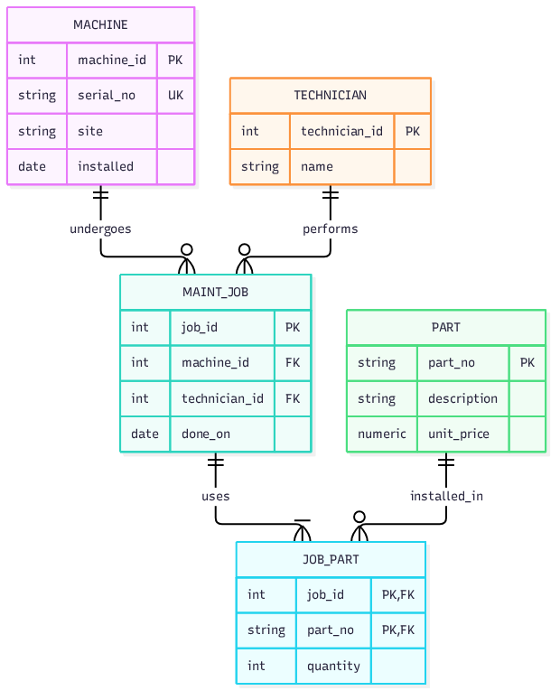

# Module 02: Legacy Schema ER Audit

This document contains the complete audit and reconstruction of the legacy maintenance database schema from **Kortmann Kunststofftechnik GmbH**.

---

## 1. Identified Entities, Attributes, and Intended Keys

After examining the schema and data in `legacy.db`, the intended domain model consists of four core entities and one associative entity (junction table) that was missing:

### 1. Machine
- **Description:** A physical manufacturing asset (e.g., CNC mill, injection molder) on the factory floor.
- **Attributes:**
  - `machine_id`: Integer, intended primary key (surrogate).
  - `serial_no`: Text, natural key (e.g., `SN-88120`), must be unique.
  - `machine_name`: Text, human-readable identifier (e.g., `cnc-01`).
  - `site`: Text, physical factory plant location (e.g., `Gütersloh`, `Bielefeld`).
  - `installed`: Date (ISO 8601 `YYYY-MM-DD`). In legacy, this was unvalidated text containing values like `'unknown'`.
- **Intended Primary Key:** `machine_id` (Surrogate PK), with `serial_no` as unique natural key.

### 2. Part
- **Description:** A replacement component or consumable used during maintenance.
- **Attributes:**
  - `part_id`: Integer, surrogate PK (or `part_no` as natural PK).
  - `part_no`: Text, natural key (e.g., `P-1001`, `P-1002`).
  - `description`: Text, component name and specification (e.g., `Ball bearing 6203`).
  - `unit_price`: Numeric/Decimal(9, 2), price in EUR. In legacy, this was stored as text `'12.50'`, breaking numeric sorting and comparisons.
- **Intended Primary Key:** `part_no` (Natural PK) or surrogate `part_id` with `UNIQUE(part_no)`.

### 3. Technician
- **Description:** A maintenance worker who carries out repairs on machines.
- **Attributes:**
  - `technician_id`: Integer, surrogate PK.
  - `name`: Text, surname or full name (e.g., `Beier`, `Klaas`, `Werther`).
- **Intended Primary Key:** `technician_id`.

### 4. MaintenanceJob
- **Description:** An event where a technician performs service on a specific machine on a given date.
- **Attributes:**
  - `job_id`: Integer, primary key.
  - `machine_id`: Integer, foreign key referencing `machine(machine_id)`.
  - `technician_id`: Integer, foreign key referencing `technician(technician_id)`.
  - `done_on`: Date, date the maintenance occurred.
- **Intended Primary Key:** `job_id`.

### 5. JobPart (Missing Junction Entity)
- **Description:** Resolves the many-to-many relationship between maintenance jobs and replacement parts.
- **Attributes:**
  - `job_id`: Integer, foreign key referencing `maint_job(job_id)`.
  - `part_no`: Text, foreign key referencing `part(part_no)`.
  - `quantity`: Integer, number of parts replaced (default 1).
- **Intended Primary Key:** Composite `(job_id, part_no)`.

---

## 2. Reconstructed ER Diagram



### Relationship Structure
- **Machine (1) to MaintenanceJob (N):** One machine undergoes zero or more maintenance jobs (`1 : n`).
- **Technician (1) to MaintenanceJob (N):** One technician performs zero or more maintenance jobs (`1 : n`).
- **MaintenanceJob (M) to Part (N):** A job uses many parts, and a part is used across many jobs (`m : n`), resolved via `job_part`.

---

## 3. Cardinality Proofs via SQL Counts

In a legacy audit, never trust documentation or column names—query the data:

### Proving Hidden M:N in `parts_used`
```sql
SELECT job_id, parts_used,
       LENGTH(parts_used) - LENGTH(REPLACE(parts_used, ',', '')) + 1 AS n_parts
FROM maint_job;
```
**Result:**
```text
job_id   parts_used    n_parts
------  -------------  -------
     1  P-1001,P-1002        2
     2  P-1003               1
     3  P-1001               1
     4  NULL                 NULL
```
**Finding:** Job 1 references 2 parts inside a single text field. Because one job has multiple parts, and inspecting `part` shows parts `P-1001` and `P-1003` appear in multiple jobs, this proves an **m : n relationship** was forced into a scalar column, violating 1NF.

---

## 4. Cardinality Modeling Assessment

- **1 : 1**: Not present in this legacy schema. (If nameplates were modeled separately, a foreign key with `UNIQUE` constraint would represent it).
- **1 : n**: Intended between `machine` and `maint_job` and between technician and `maint_job`. The legacy schema attempted this with plain text columns (`machine_name TEXT`, `technician TEXT`), but omitted foreign key constraints, resulting in orphan rows.
- **m : n**: Intended between `maint_job` and `part`. The legacy schema completely hid this by packing comma-separated values into `maint_job.parts_used`, breaking relational joins and index support.
