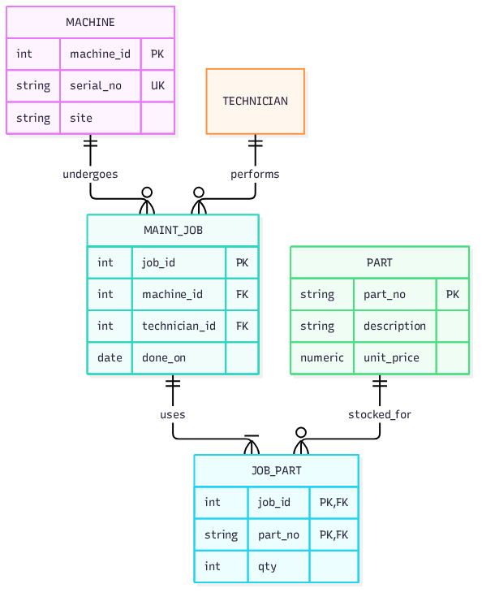
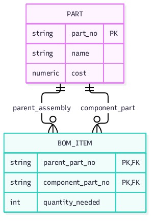
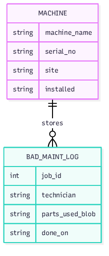

# Mermaid ER Lab — Curated Diagrams & Critiques

My notes and experiments for Task 5: collecting interesting ER sketches, testing round-trips, and critiquing cardinality and inheritance.

---

## 1. Curated Diagrams

### The Good: Normalized Factory Schema
A clean, standard relational schema with proper Crow's-foot connectors and an explicit junction table (`JOB_PART`) to handle the m:n relationship.



```text
MACHINE ||--o{ MAINT_JOB : "undergoes"
TECHNICIAN ||--o{ MAINT_JOB : "performs"
MAINT_JOB ||--|{ JOB_PART : "uses"
PART ||--o{ JOB_PART : "stocked_for"
```
*Why it works:* Clean 1NF, clear primary and foreign keys, no string packing.

---

### The Strange: Recursive Bill of Materials (BOM)
A self-referencing relationship where a component part can be assembled from other parts.



```text
PART ||--o{ BOM_ITEM : "parent_assembly"
PART ||--o{ BOM_ITEM : "component_part"
```
*Why it's strange:* It turns a hierarchical tree structure into rows and foreign keys. To query the full assembly depth, you need recursive SQL (`WITH RECURSIVE`).

---

### The Confusing: Overloaded Denormalized Log
An anti-pattern where maintenance events and parts lists are crammed directly into an unconstrained text column.



```text
MACHINE ||--o{ BAD_MAINT_LOG : "stores"
```
*Why it's bad:* Violates 1NF, hides which parts were used, prevents foreign keys, and makes querying impossible without string splits.

---

## 2. Round-Trip AI Testing (Schema ↔ Diagram)

- **SQL to Diagram:** Pasting raw `CREATE TABLE` statements to an LLM made it draw relationships that were never actually enforced in SQL. Because columns were named `machine_name` and `technician`, the model assumed clean foreign keys were in place. Always verify relationships with `COUNT` queries against real data.
- **Diagram to SQL:** Asking an LLM to generate SQL from Crow's-foot diagrams worked well for tables and basic foreign keys, but it usually skipped custom check constraints (`CHECK(quantity > 0)`) unless explicitly prompted.

---

## 3. Real Talk on Cardinality ("1:4 Wheels" Trap)

Textbooks love using *"A car has 4 wheels (1:4)"* as an example. But in real life:
- Cars have spare tires (1:5).
- Trailers or 18-wheelers have different counts.
- A wheel can be taken off for maintenance (1:3).

**Takeaway:** Cardinalities in ER diagrams should stay **1:1, 1:n, or m:n**. Hard numbers like "exactly 4" are business rules. They belong in application validation or `CHECK` constraints, not baked into the schema structure.

---

## 4. Inheritance: Don't Over-Engineer

Mermaid `erDiagram` doesn't support inheritance natively (you have to use `classDiagram` or plain tables).
- In factory IoT setups, a single table with a `machine_type` column (Single Table Inheritance) is usually much simpler and faster to query than splitting machines into multiple subtype tables.
- Keep schemas simple and avoid deep class hierarchies in relational databases.
