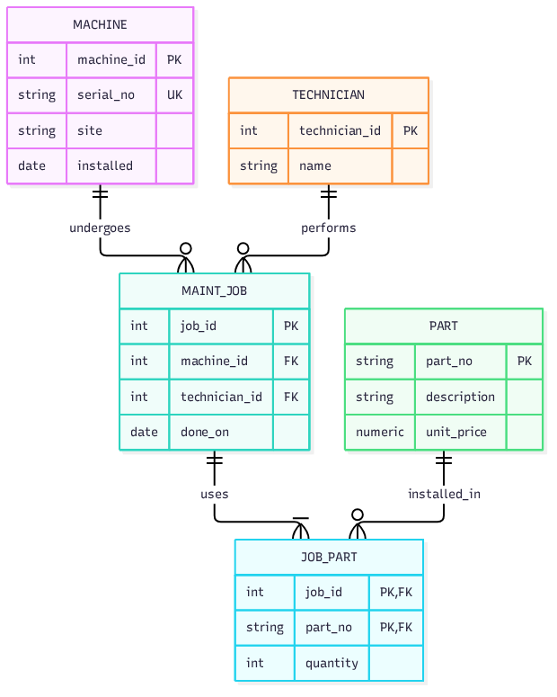
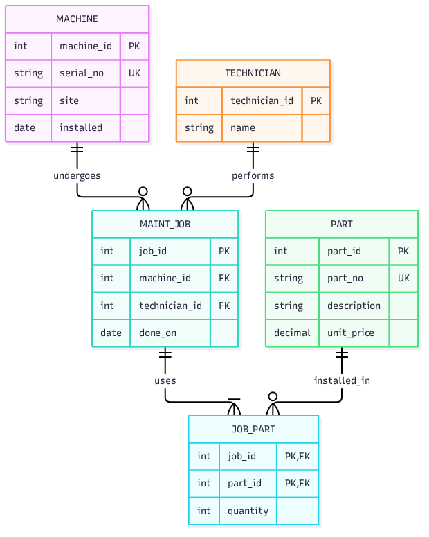
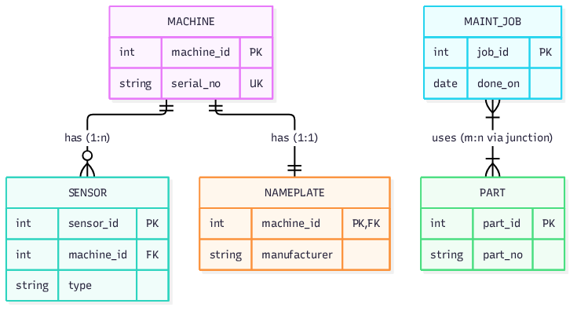
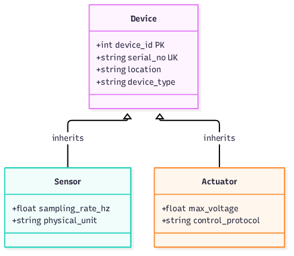
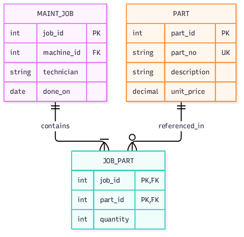
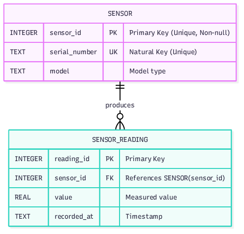
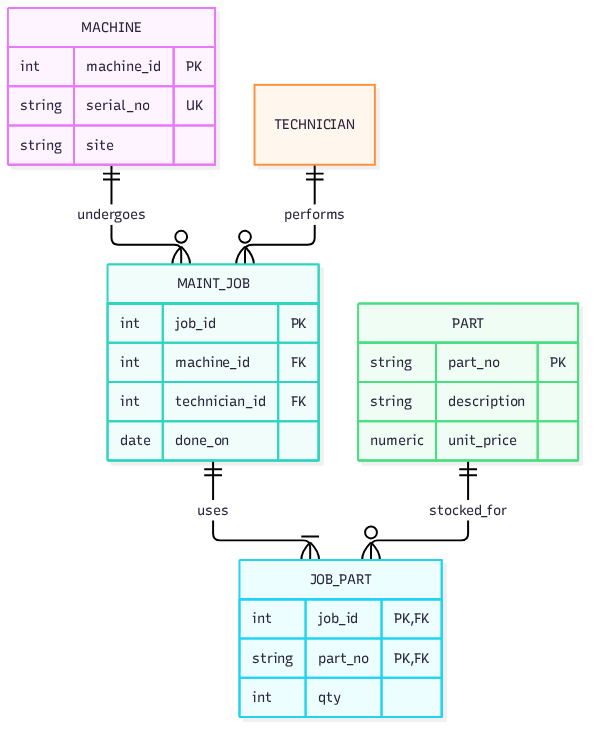
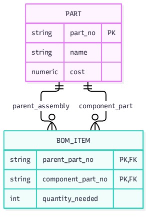
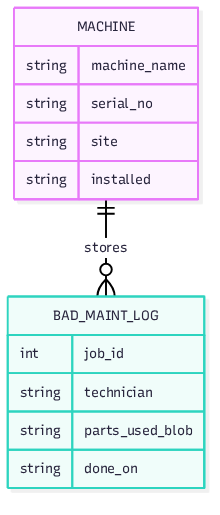
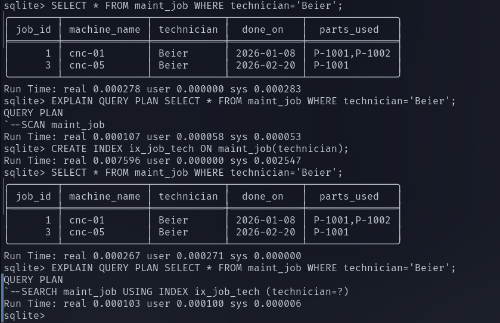

# Pictures for Module 2

This folder contains diagrams and screenshots for the Module 02 conceptual data modeling, legacy schema audit, and Mermaid lab exercises.

---

### 1. `reconstructed-erd.png` — Reconstructed Maintenance Schema
* **Context:** Created for **Task 1: Reconstruct the ER Model**.
* **What it is:** The complete, repaired Entity-Relationship diagram for the Kortmann Kunststofftechnik legacy maintenance system. It models the intended entities (`MACHINE`, `TECHNICIAN`, `MAINT_JOB`, `PART`) and adds the missing junction entity `JOB_PART` with explicit Crow's-foot cardinalities.

---

### 2. `erd-basics.png` — Conceptual ER Basics
* **Context:** Created for **Pod Study: Entities, Attributes, Relationships & Cardinality**.
* **What it is:** Demonstrates the core building blocks of relational modeling—how independent entities connect via 1:1, 1:n, and m:n relationships using foreign keys and junction tables.

---

### 3. `crows-foot-notation.png` — Crow's-Foot / IE Notation Guide
* **Context:** Created for **Pod Study Pointers: Crow's-Foot / IE Notation**.
* **What it is:** Shows how relationship bounds are visually drawn: `||` for exactly one (mandatory), `|o` for zero or one (optional), and `|{` or `o{` for many. Applied to machines, sensors, nameplates, and maintenance jobs.

---

### 4. `eer-inheritance.png` — Enhanced ER (EER) Device Hierarchy
* **Context:** Created for **Pod Study Pointers & Task 4 (Inheritance Stretcher)**.
* **What it is:** Class hierarchy diagram illustrating generalization/specialization. A base `Device` entity shares common hardware attributes (`serial_no`, `location`), while `Sensor` and `Actuator` inherit from it with their specific physical attributes.

---

### 5. `1nf-decomposition.png` — First Normal Form (1NF) Fix
* **Context:** Created for **Pod Study Pointers: Why Comma-Separated Lists Break 1NF**.
* **What it is:** Shows how the flawed legacy `maint_job.parts_used` column (storing multi-valued strings like `'P-1001,P-1002'`) is decomposed into an atomic 1NF design using the `JOB_PART` junction table.

---

### 6. `primary-keys.png` — Natural vs. Surrogate Keys
* **Context:** Created for **Pod Study Pointers: Key Selection Strategies**.
* **What it is:** Illustrates using an auto-incrementing integer surrogate key (`sensor_id`) as the primary key and foreign key target, while protecting the business serial number (`serial_number`) with a `UNIQUE` natural key constraint.

---

### 7. `good-factory-erd.png` — Mermaid Lab: The Good
* **Context:** Created for **Task 5: Mermaid ER Lab (Curated Diagrams)**.
* **What it is:** A model example of a clean, production-ready factory database schema with no string packing, clear primary/foreign keys, and explicit junction tables.

---

### 8. `strange-bom-erd.png` — Mermaid Lab: The Strange
* **Context:** Created for **Task 5: Mermaid ER Lab (Curated Diagrams)**.
* **What it is:** A recursive Bill of Materials (BOM) self-referencing relationship where parts can be composed of other parts, modeling tree structures in flat relational tables.

---

### 9. `confusing-overloaded-erd.png` — Mermaid Lab: The Confusing
* **Context:** Created for **Task 5: Mermaid ER Lab (Curated Diagrams)**.
* **What it is:** An anti-pattern diagram showing an overloaded denormalized table where parts lists and job logs are dumped into free-text columns, breaking relational integrity.

---

### 10. `SCAN&SEARCH.png` — Query Execution Screenshot
* **Context:** Captured during terminal query testing and database auditing in Module 02.
* **What it is:** Screenshot showing command-line query execution and SQLite query plan behavior (SCAN vs. SEARCH) when auditing legacy table indices.

