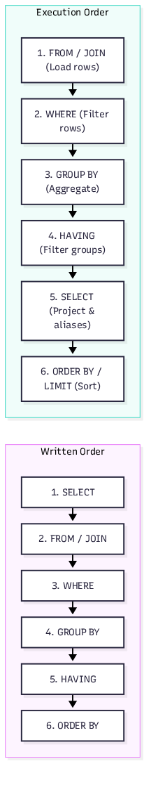
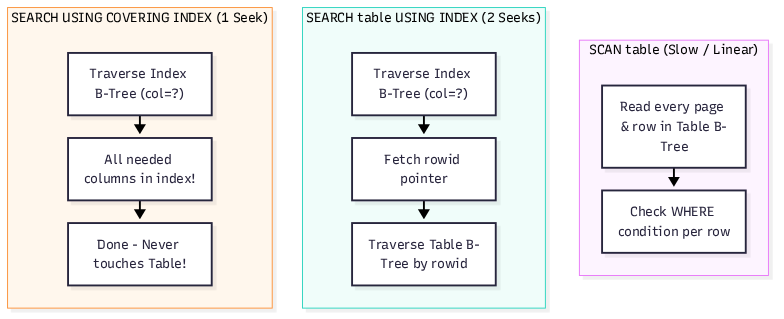
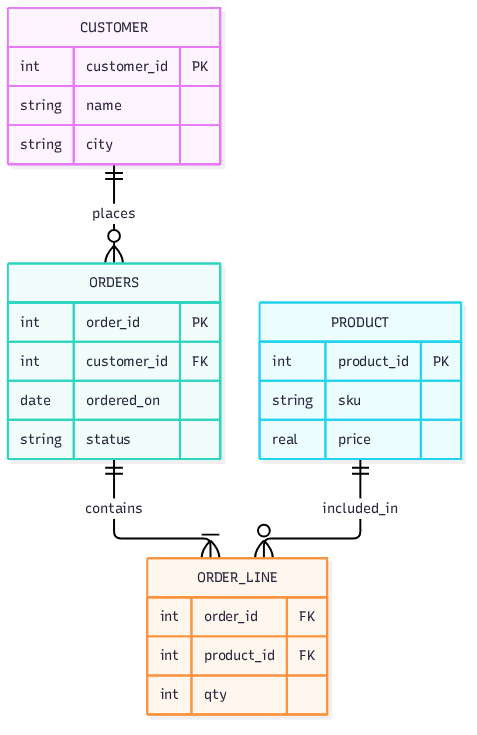
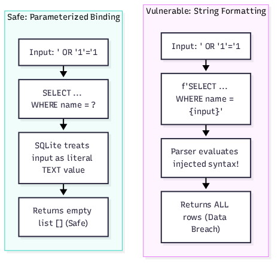

# Module 3 — LLM-Assisted SQL & Query Profiling

**Portfolio of:** Trainn  
**Class:** HSBI Database Class  

In this module, I worked with a warehouse dataset of ~240,000 order lines to profile complex SQL queries, evaluate index performance with `EXPLAIN QUERY PLAN`, test AI-generated queries, and prevent SQL injection using parameter binding.

---

## 🎯 Learning Goals

| # | Official Learning Goal | Where Proven in Portfolio |
|---|---|---|
| **1** | Build complex **DQL** queries: joins, aggregation with `GROUP BY`/`HAVING`, subqueries, and window functions. | [Task 1: LLM Query](#task-1-ask-the-llm-then-check-the-plan) & [Task 5: Stretcher](#task-5-stretcher-window-functions--subquery-rewrites) |
| **2** | Read **`EXPLAIN QUERY PLAN`** as *primary evidence*: say what the engine will do for a given query, tell a `SCAN` from a `SEARCH`, and a table lookup from a covering index. | [Pod Study: Reading Query Plans](#reading-query-plans) & [Plan Prediction vs. Actual Plan](#plan-prediction-vs-actual-plan) |
| **3** | **Benchmark** the effect of an index and explain when the planner ignores one. | [Task 2: Index Benchmark](#task-2-index-benchmark-prove-it-or-disprove-it) |
| **4** | Generate a query with an **LLM**, then **verify** it: correctness, performance, and edge cases. | [Task 1: Ask the LLM, Then Check the Plan](#task-1-ask-the-llm-then-check-the-plan) |
| **5** | **Prevent SQL injection** with bound parameters and demonstrate why string concatenation is exploitable. | [Task 3: The Injection Drill](#task-3-the-injection-drill) |

---

## Pod Study: The Six Clauses & Query Plans

SQL queries are written in one order, but evaluated by the engine in a different order:



- **Evaluation Order**: `FROM / JOIN` → `WHERE` → `GROUP BY` → `HAVING` → `SELECT` → `ORDER BY / LIMIT`.
- **Why it matters**: You cannot reference a `SELECT` column alias inside a `WHERE` clause because filtering occurs before column projection.

### Relational Algebra Cheat Sheet
- **Selection ($\sigma$)**: `WHERE` (filters rows).
- **Projection ($\pi$)**: `SELECT` (picks columns).
- **Join ($\bowtie$)**: `JOIN ... ON` (combines tables).
- **Grouping ($\gamma$)**: `GROUP BY` + aggregations (`SUM`, `COUNT`).

### Reading Query Plans
`EXPLAIN QUERY PLAN` is the real proof of how SQLite executes a query:



- `SCAN table`: Full table scan. Fine for tiny tables, slow for large tables.
- `SEARCH table USING INDEX idx`: Uses the index B-tree to find matching rowids, then looks up the row in the table (2 seeks).
- `SEARCH table USING COVERING INDEX idx`: All required columns exist in the index B-tree. Never touches the table (1 seek).

*Pod notes and plan safari logs are in [Module03/sql-notes.md](sql-notes.md).*

---

## Setup: Warehouse Dataset

I created `Module03/setup.sql` and loaded ~240,000 rows into `Module03/warehouse.db`:



```sh
sqlite3 Module03/warehouse.db < Module03/setup.sql
```

Row counts verified:
- `customer`: 2,000
- `product`: 500
- `orders`: 60,000
- `order_line`: 240,000

---

## Task 1: Ask the LLM, Then Check the Plan

**Prompt given to LLM:**  
> *"SQLite schema: customer(customer_id, name, city), product(product_id, sku, price), orders(order_id, customer_id, ordered_on, status), order_line(order_id, product_id, qty). Write a query that returns, for each city, the number of distinct customers and the total revenue (sum of qty*price) of orders placed in 2025, ordered by revenue descending."*

### LLM Query:
```sql
SELECT c.city, COUNT(DISTINCT c.customer_id) AS customers,
       SUM(ol.qty * p.price) AS revenue
FROM customer c
JOIN orders o      ON o.customer_id = c.customer_id
JOIN order_line ol ON ol.order_id = o.order_id
JOIN product p     ON p.product_id = ol.product_id
WHERE o.ordered_on >= '2025-01-01' AND o.ordered_on < '2026-01-01'
GROUP BY c.city
ORDER BY revenue DESC;
```

### Plan Prediction vs. Actual Plan:
- **Prediction**: I expected a full scan on `order_line` and index searches on primary keys.
- **Actual `EXPLAIN QUERY PLAN`**:
  ```text
  |--SCAN ol
  |--SEARCH o USING INTEGER PRIMARY KEY (rowid=?)
  |--SEARCH c USING INTEGER PRIMARY KEY (rowid=?)
  |--SEARCH p USING INTEGER PRIMARY KEY (rowid=?)
  |--USE TEMP B-TREE FOR GROUP BY
  |--USE TEMP B-TREE FOR count(DISTINCT)
  `--USE TEMP B-TREE FOR ORDER BY
  ```

**Correctness Check**: The query is correct. It uses `COUNT(DISTINCT c.customer_id)` so multiple orders by the same customer don't inflate customer counts, and uses an ISO string range for 2025 (`>= '2025-01-01' AND < '2026-01-01'`).

---

## Task 2: Index Benchmark (Prove It or Disprove It)

I wrote [Module03/bench.py](bench.py) to run each query 3 times and take the median time.

### Benchmark Results Table

| Index State | Dashboard Query Time | Dashboard Plan | Single-Day Query Time | Single-Day Plan |
|---|---|---|---|---|
| **Baseline (No extra indexes)** | **260.50 ms** | `SCAN ol`, `SEARCH o/c/p (rowid=?)` | **6.23 ms** | `SCAN o`, `SEARCH c (rowid=?)` |
| **+ `ix_orders_ordered_on`** | **256.00 ms** | Plan unchanged (`SCAN ol`) | **0.27 ms** (23x faster!) | `SEARCH o USING INDEX ix_orders_ordered_on` |
| **+ `ix_orderline_order`** | **1120.63 ms** (4x SLOWER!) | `SEARCH o USING INDEX`, `SEARCH ol USING INDEX` | 0.27 ms | `SEARCH o USING INDEX` |
| **+ `ix_orderline_product`** | **1071.98 ms** | Plan unchanged | 0.27 ms | `SEARCH o USING INDEX` |

### Key Benchmark Discoveries:
1. **The 23x Speedup Win**: On the single-day query (`WHERE o.ordered_on = '2026-02-14'`), adding `ix_orders_ordered_on` dropped execution time from `6.23 ms` down to `0.27 ms` because it only visits matching rows instead of scanning 60,000 orders.
2. **The 4x Slowdown Trap**: Adding `ix_orderline_order` made the dashboard query **4 times slower** (jumped from 260 ms to 1,120 ms). The query planner switched from one linear sequential scan of `order_line` to thousands of random B-tree seeks. An index does not guarantee a speedup!
3. **The Negative Result (Function Wrap)**: Wrapping the column in a function (`WHERE date(o.ordered_on) = '2026-02-14'`) disables the index completely, forcing a full `SCAN o` taking `9.76 ms`.

---

## Task 3: The Injection Drill

I ran [Module03/injection_demo.py](injection_demo.py) to test raw string formatting versus parameter binding.



### Output:
```text
normal   : [(1, 'Customer 1')]
injected : [(1, 'Customer 1'), (2, 'Customer 2'), (3, 'Customer 3')] ...
safe     : []
```

### Why Escaping Fails and Parameter Binding Works:
- **String formatting flaw**: `f"SELECT ... WHERE name = '{name}'"` treats user input as executable SQL code. Passing `' OR '1'='1` changes the AST logic to return all rows.
- **Why manual escaping is bad**: Escaping quotes by hand is error-prone because attackers can bypass filters using alternate encodings, null bytes, or numeric injection contexts where no quotes exist.
- **Why parameter binding works**: In `WHERE name = ?`, the database parser separates the query structure from the data. The input `' OR '1'='1` is treated strictly as literal text, safely returning `[]`.

---

## Task 4: Relational Algebra Representation

For the single-day lookup query:
```sql
SELECT o.order_id, o.ordered_on, c.name
FROM orders o 
JOIN customer c ON c.customer_id = o.customer_id
WHERE o.ordered_on = '2026-02-14';
```

**Relational Algebra Expression:**
$$\pi_{order\_id, ordered\_on, name} \Big( \sigma_{ordered\_on = '2026-02-14'} (orders \bowtie_{orders.customer\_id = customer.customer\_id} customer) \Big)$$

- **$\bowtie$**: Joins `orders` and `customer` on `customer_id`.
- **$\sigma$**: Filters rows where `ordered_on = '2026-02-14'`.
- **$\pi$**: Projects only `order_id`, `ordered_on`, and customer `name`.

---

## Task 5: Stretcher (Window Functions & Subquery Rewrites)

I rewrote the query calculating late orders per customer two ways:

### 1. Correlated Subquery Rewrite:
```sql
SELECT c.customer_id, c.name,
       (SELECT COUNT(*) FROM orders o WHERE o.customer_id = c.customer_id AND o.status = 'late') AS late_orders
FROM customer c
WHERE late_orders > 0
ORDER BY late_orders DESC;
```
*Plan:* `SCAN c` with two `CORRELATED SCALAR SUBQUERY` passes scanning `orders`. Very slow for large tables.

### 2. Window Function Rewrite:
```sql
SELECT DISTINCT c.customer_id, c.name,
       COUNT(*) OVER (PARTITION BY c.customer_id) AS late_orders
FROM orders o
JOIN customer c ON c.customer_id = o.customer_id
WHERE o.status = 'late'
ORDER BY late_orders DESC;
```
*Plan:* Uses co-routines, `SCAN o`, and `SEARCH c USING INTEGER PRIMARY KEY`, then sorts with a temp B-tree.

**Comparison:** The standard `GROUP BY` query is the cleanest and fastest. Window functions are great for running totals and ranks, but for simple counts, `GROUP BY` produces the most straightforward plan.

---

## Reflection
My personal takeaways and thoughts on AI verification and query profiling:  
**[Reflection 3](/Reflections/ref03.md)**
