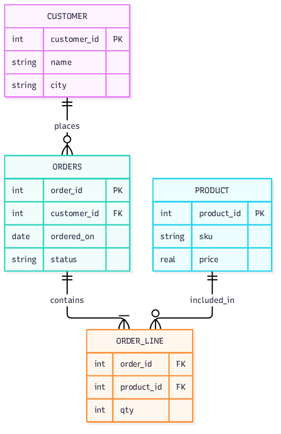
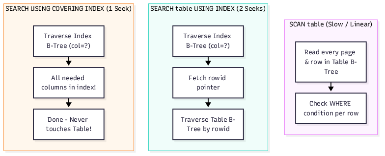
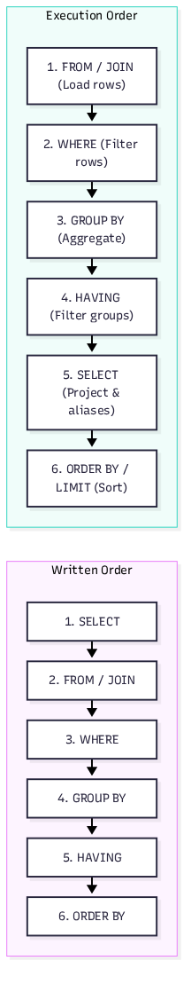
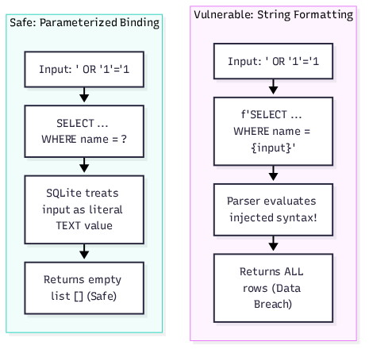

# Pictures for Module 3

Screenshots and diagrams documenting query profiling, plans, and security testing.

---

### 1. `warehouse-schema.png` — Warehouse Schema
* **Context:** Studio Lab Setup.
* **Description:** The entity relationships between `customer`, `orders`, `order_line`, and `product` in `warehouse.db`.

---

### 2. `query-plan-flow.png` — Query Plan Execution (SCAN vs. SEARCH)
* **Context:** Task 1 & Task 2 Query Profiling.
* **Description:** Compares a full table scan against standard index lookups (2 B-tree seeks) and covering indexes (1 seek).

---

### 3. `sql-clause-order.png` — Written vs. Evaluated Order
* **Context:** Pod Study (The Six Clauses).
* **Description:** Shows why `SELECT` aliases fail in `WHERE` clauses because the engine evaluates `FROM -> WHERE -> GROUP BY -> HAVING -> SELECT -> ORDER BY`.

---

### 4. `sql-injection-flow.png` — SQL Injection vs. Parameter Binding
* **Context:** Task 3 (The Injection Drill).
* **Description:** Demonstrates how string formatting lets an attacker inject SQL logic, whereas `?` parameter binding treats payloads as raw data.

