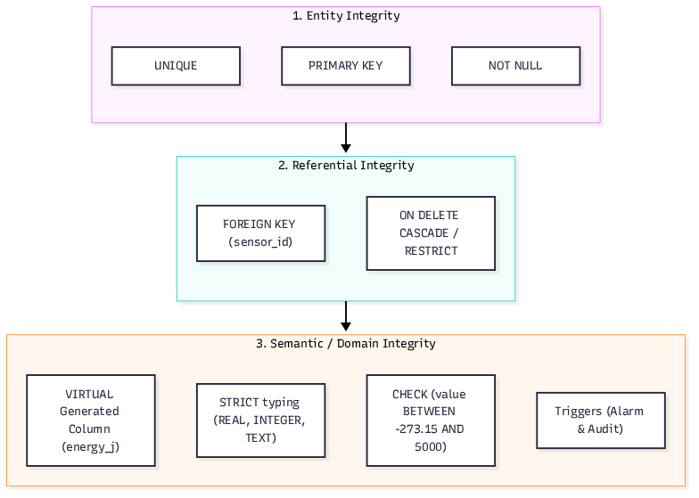
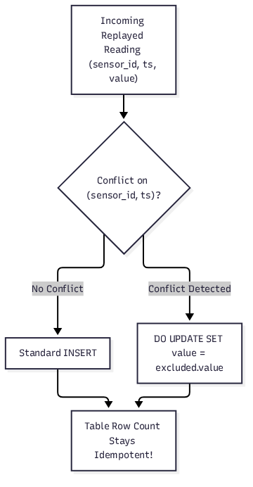
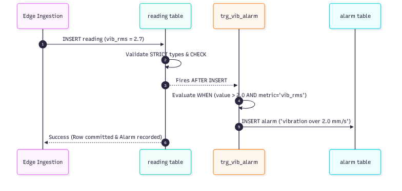

# Module 4 — Data Integrity, Constraints & Edge Triggers

**Portfolio of:** Trainn  
**Class:** HSBI Database Class  

In this module, I worked on enforcing data integrity directly at the edge in `Module04/edge.db`. Without a central server or DBA to catch bad rows, an edge database must enforce physical and logical rules itself: rejecting impossible sensor readings, calculating derived values automatically, raising alarms on critical thresholds, and handling network replay duplicates with `UPSERT`.

---

## 🎯 Learning Goals

| # | Official Learning Goal | Where Proven in Portfolio |
|---|---|---|
| **1** | Create tables with the full constraint toolkit: `NOT NULL`, `UNIQUE`, `CHECK`, `PRIMARY KEY`, `FOREIGN KEY`, and `STRICT` typing. | [Setup: The Edge Schema](#setup-the-edge-schema) & [Task 1: Proving Constraints Work](#task-1-proving-constraints-work) |
| **2** | Use **generated columns** to derive values at the engine instead of in application code. | [Setup: Schema Definition (`energy_j`)](#setup-the-edge-schema) & [Task 1 Evidence](#task-1-proving-constraints-work) |
| **3** | Write **triggers** that enforce domain rules and maintain audit/rollup tables automatically. | [Task 3: Triggers for Alarms and Audits](#task-3-triggers-for-alarms-and-audits) |
| **4** | Use **DML** correctly — including `UPSERT` (`ON CONFLICT`) for idempotent edge ingestion. | [Task 2: Idempotent Ingestion with UPSERT](#task-2-idempotent-ingestion-with-upsert) |
| **5** | Reason about **access control (DCL)**: who may read or write, and how that maps from server `GRANT`s to an embedded, local-first world. | [Task 4: Access Control Without a Server](#task-4-access-control-without-a-server) |

---

## Pod Study: The Three Layers of Integrity

Integrity is structured in three defensive layers:



1. **Entity Integrity**: Every row must be identifiable and complete (`PRIMARY KEY`, `NOT NULL`, `UNIQUE`).
2. **Referential Integrity**: Links must reference real records (`FOREIGN KEY ... REFERENCES`). Requires `PRAGMA foreign_keys = ON;`.
3. **Semantic / Domain Integrity**: Stored values must conform to real-world physics (`CHECK`, `STRICT` tables, generated columns, triggers).

*Pod notes and constraint tests are logged in [Module04/integrity-notes.md](integrity-notes.md).*

---

## Setup: The Edge Schema

I created `Module04/setup.sql` and initialized `Module04/edge.db`:

```sql
PRAGMA foreign_keys = ON;
DROP TABLE IF EXISTS audit;
DROP TABLE IF EXISTS alarm;
DROP TABLE IF EXISTS reading;
DROP TABLE IF EXISTS sensor;

CREATE TABLE sensor(
    sensor_id   INTEGER PRIMARY KEY,
    machine_id  TEXT    NOT NULL,
    metric      TEXT    NOT NULL CHECK (metric IN ('temp_c','vib_rms','spindle_load')),
    unit        TEXT    NOT NULL,
    UNIQUE (machine_id, metric)
) STRICT;

CREATE TABLE reading(
    reading_id  INTEGER PRIMARY KEY,
    sensor_id   INTEGER NOT NULL REFERENCES sensor(sensor_id),
    ts          TEXT    NOT NULL,
    value       REAL    NOT NULL,
    interval_s  INTEGER NOT NULL CHECK (interval_s > 0),
    energy_j    REAL    GENERATED ALWAYS AS (value * interval_s) VIRTUAL,
    CHECK (value >= -273.15 AND value <= 5000)
) STRICT;
```

---

## Task 1: Proving Constraints Work

I tested valid data and verified the virtual generated column:
```sql
INSERT INTO sensor VALUES (1,'cnc-01','temp_c','degC'), (2,'cnc-01','vib_rms','mm/s');
INSERT INTO reading(sensor_id, ts, value, interval_s) VALUES (1,'2026-03-01 08:00:00', 41.5, 2);
SELECT reading_id, sensor_id, ts, value, interval_s, energy_j FROM reading;
```
*Result:* `energy_j` automatically calculated `41.5 * 2 = 83.0` without any application logic.

### Rejected Test Cases & Error Proofs

I executed invalid statements against `edge.db`. Each layer rejected invalid data as expected:

1. **Domain Check (`value <= 5000`)**:
   ```sql
   INSERT INTO reading(sensor_id, ts, value, interval_s) VALUES (1,'2026-03-01 08:00:01', 9000, 1);
   ```
   *Error:* `CHECK constraint failed: value >= -273.15 AND value <= 5000`

2. **STRICT Typing (Text into REAL)**:
   ```sql
   INSERT INTO reading(sensor_id, ts, value, interval_s) VALUES (1,'2026-03-01 08:00:02', 'hot', 1);
   ```
   *Error:* `cannot store TEXT value in REAL column reading.value`

3. **Referential Integrity (Missing Parent Sensor)**:
   ```sql
   INSERT INTO reading(sensor_id, ts, value, interval_s) VALUES (99,'2026-03-01 08:00:03', 40, 1);
   ```
   *Error:* `FOREIGN KEY constraint failed`

4. **Entity Integrity (Duplicate Machine Metric)**:
   ```sql
   INSERT INTO sensor VALUES (3,'cnc-01','temp_c','degC');
   ```
   *Error:* `UNIQUE constraint failed: sensor.machine_id, sensor.metric`

---

## Task 2: Idempotent Ingestion with UPSERT

When edge gateways reconnect after network loss, replaying telemetry packets must not create duplicate records:



```sql
-- Ensure natural key uniqueness
CREATE UNIQUE INDEX ux_reading_sensor_ts ON reading(sensor_id, ts);

-- Replay-safe UPSERT
INSERT INTO reading(sensor_id, ts, value, interval_s)
VALUES (1,'2026-03-01 08:00:00', 41.7, 1)
ON CONFLICT(sensor_id, ts) DO UPDATE SET value = excluded.value;
```

I automated this in [Module04/ingest.py](ingest.py) reading [Module04/readings.csv](readings.csv):
```sh
$ python3 Module04/ingest.py
Run 1 count: 5
Run 2 count: 5 (idempotent, no duplicates)
```
The row count remained 5 across successive runs, proving idempotency.

---

## Task 3: Triggers for Alarms and Audits

I added automated alarms and update auditing:



```sql
CREATE TABLE alarm(
    alarm_id  INTEGER PRIMARY KEY,
    sensor_id INTEGER NOT NULL REFERENCES sensor(sensor_id),
    ts        TEXT NOT NULL,
    value     REAL NOT NULL,
    reason    TEXT NOT NULL
) STRICT;

CREATE TABLE audit(
    audit_id  INTEGER PRIMARY KEY,
    reading_id INTEGER NOT NULL,
    old_value REAL,
    new_value REAL,
    changed_at TEXT NOT NULL DEFAULT (datetime('now'))
) STRICT;

-- Alarm trigger when vibration exceeds 2.0 mm/s
CREATE TRIGGER trg_vib_alarm
AFTER INSERT ON reading
FOR EACH ROW
WHEN NEW.value > 2.0 AND (SELECT metric FROM sensor WHERE sensor_id = NEW.sensor_id) = 'vib_rms'
BEGIN
    INSERT INTO alarm(sensor_id, ts, value, reason)
    VALUES (NEW.sensor_id, NEW.ts, NEW.value, 'vibration over 2.0 mm/s');
END;

-- Audit trail trigger on value updates
CREATE TRIGGER trg_reading_audit
AFTER UPDATE OF value ON reading
FOR EACH ROW
BEGIN
    INSERT INTO audit(reading_id, old_value, new_value)
    VALUES (NEW.reading_id, OLD.value, NEW.value);
END;
```

### Verification:
```sql
INSERT INTO reading(sensor_id, ts, value, interval_s) VALUES (2,'2026-03-01 09:00:00', 2.7, 1);
UPDATE reading SET value = 1.4 WHERE sensor_id = 2 AND ts = '2026-03-01 09:00:00';

SELECT * FROM alarm;
-- Output: 1 | 2 | 2026-03-01 09:00:00 | 2.7 | vibration over 2.0 mm/s

SELECT * FROM audit;
-- Output: 1 | 6 | 2.7 | 1.4 | 2026-11-25 14:12:29
```

**Trigger Cost Benchmark:**  
Inserting 10,000 rows took:
- **Without trigger**: `14.15 ms`
- **With trigger**: `17.57 ms` (~24% overhead for evaluating conditions on each insert).

---

## Task 4: Access Control Without a Server

Because SQLite has no `CREATE USER` or `GRANT`, access control is enforced at the file system and connection level:

1. **Safe Reporting View**:
   ```sql
   CREATE VIEW machine_health AS
     SELECT s.machine_id, s.metric, MAX(r.value) AS peak, COUNT(*) AS n
     FROM sensor s JOIN reading r USING(sensor_id) GROUP BY s.machine_id, s.metric;
   ```
2. **Read-Only Connection Mode**:
   ```sh
   $ sqlite3 "file:Module04/edge.db?mode=ro" "SELECT COUNT(*) FROM reading;"
   6
   $ sqlite3 "file:Module04/edge.db?mode=ro" "DELETE FROM reading;"
   Error: attempt to write a readonly database
   ```
3. **File System Permissions (`chmod 444`)**:
   Locks the `.db` file directly so standard OS permissions protect it from modification.

### Server vs. Embedded Access Control:
In PostgreSQL, granular access is managed through database roles (`GRANT SELECT ON ... TO report_user`). In an embedded environment (like an edge gateway), file permissions and read-only connection URIs (`mode=ro`) are ideal because there is only one local process and attack surface is limited to the local machine. However, for a multi-tenant web application, file-level permissions are insufficient because all web requests typically share a single OS user process.

---

## Task 5: Trigger Timing (BEFORE vs. AFTER vs. INSTEAD OF)

- **`BEFORE INSERT`**: Runs prior to constraint validation. If the insert later fails a `CHECK` constraint, side effects generated by a `BEFORE` trigger can leave orphaned log rows.
- **`AFTER INSERT`**: Guarantees the row has already passed all schema rules and is committed. This is the correct choice for alarms and audit logs.
- **`INSTEAD OF`**: Only valid on views. Used to make complex non-updatable views accept `INSERT`/`UPDATE` statements by rerouting values to base tables.

---

## Reflection
My reflection for this module is documented in:  
**[Reflection 4](/Reflections/ref04.md)**
