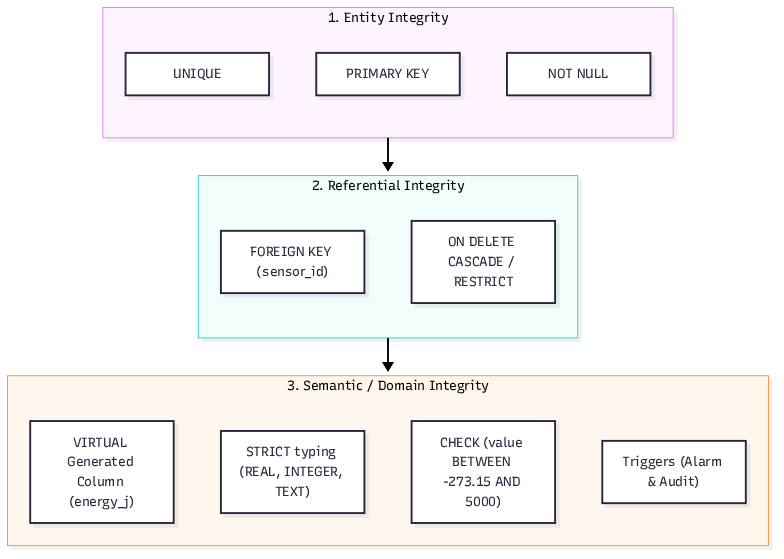
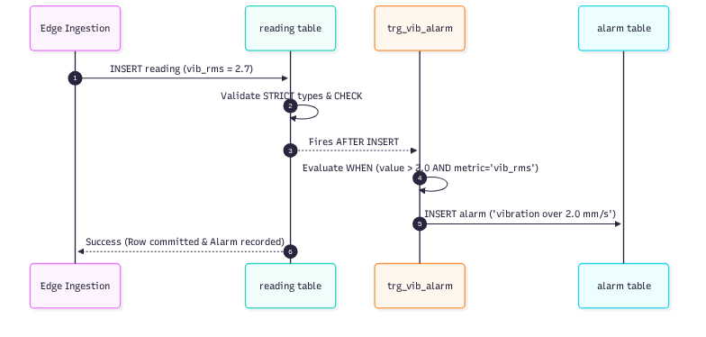
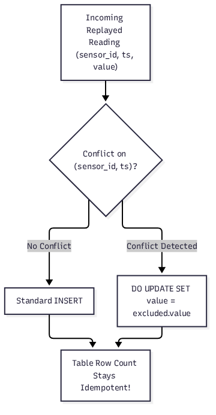

# Pictures for Module 4

Diagrams illustrating data integrity layers, trigger execution flows, and UPSERT mechanics.

---

### 1. `integrity-layers.png` — Three Layers of Integrity
* **Context:** Pod Study (Entity, Referential, and Domain/Semantic integrity).
* **Description:** Breaks down how SQL constraints map to integrity layers (`PRIMARY KEY`, `FOREIGN KEY`, `CHECK`, `STRICT`, generated columns, and triggers).

---

### 2. `triggers-alarm-flow.png` — Edge Alarm Trigger Sequence
* **Context:** Task 3 (Triggers for Alarms and Audit).
* **Description:** Shows how an `AFTER INSERT` trigger evaluates threshold rules on edge sensors and automatically writes an alarm event without trusting application code.

---

### 3. `upsert-flow.png` — Idempotent Ingestion with UPSERT
* **Context:** Task 2 (Idempotent Edge Ingestion).
* **Description:** How `ON CONFLICT` prevents replayed edge telemetry packets from producing duplicate rows.

