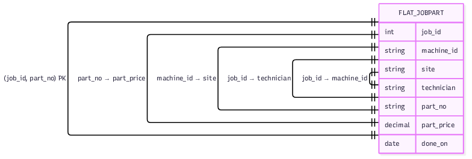
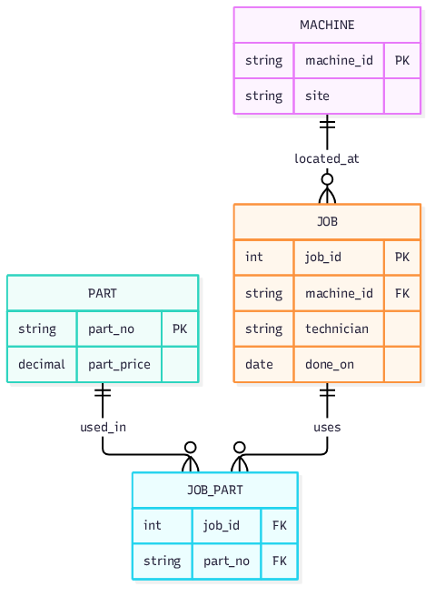
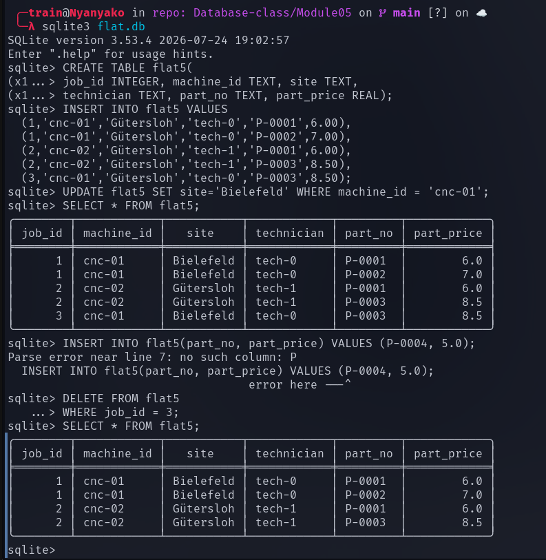
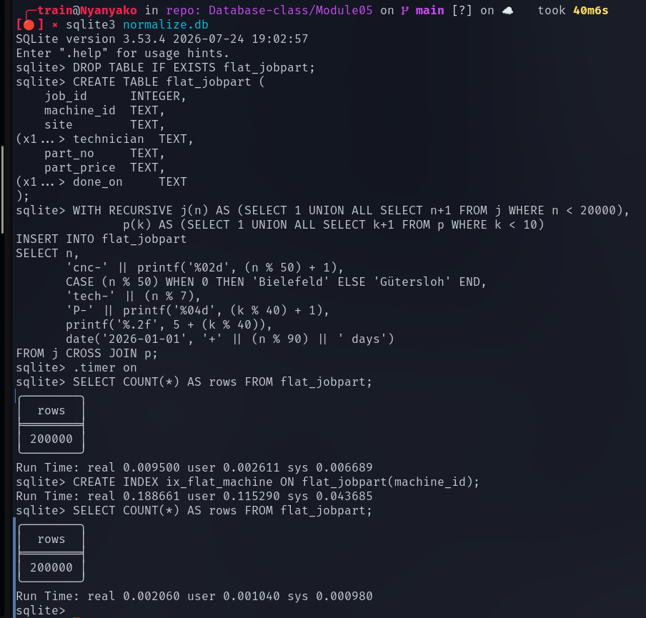
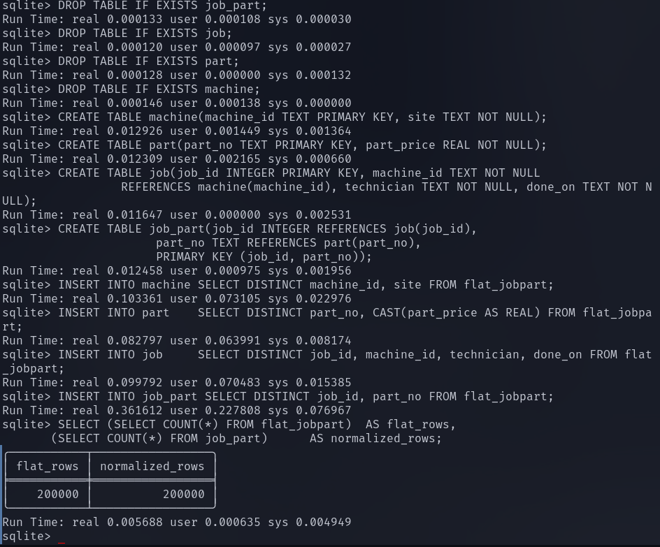
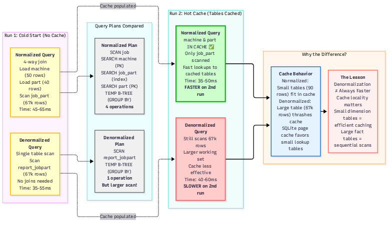
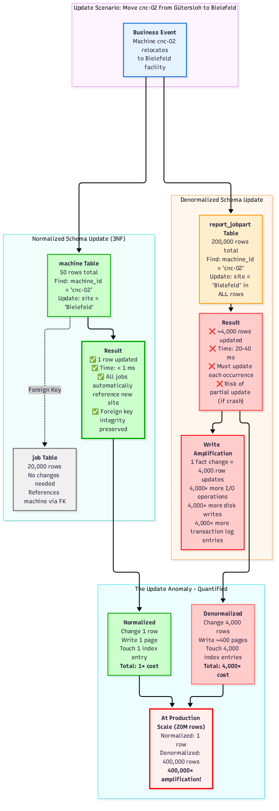
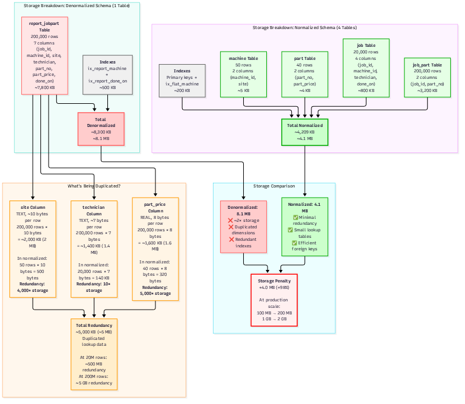

# Module 5 — Normalization vs. Denormalization

**Portfolio of:** Trainn  
**Class:** HSBI Database Class  

In this module, I investigated the trade-offs between a fully normalized database (3NF) and an unnormalized flat table using a factory dataset of 200,000 maintenance rows. The goal was to prove the three classic anomalies (update, insert, delete), decompose the schema into 3NF, and benchmark query speeds, update costs, and disk storage.

---

## Round 1: Functional Dependencies & Redundancy

We started with a single flat table holding maintenance jobs, machines, technicians, and parts:

```text
(job_id, machine_id, site, technician, part_no, part_price)
```

### The Functional Dependencies (FDs)
- `machine_id → site`: Every machine belongs to one physical plant (domain rule).
- `part_no → part_price`: Every part has a catalog price.
- `job_id → machine_id, technician`: Each job is done on one machine by one technician.
- `job_id → site`: Transitive dependency (derived via `job_id → machine_id → site`).
- `(job_id, part_no) → ALL`: The composite candidate key.

### Schemas: Before vs. After
| Current Flat Schema (Massive Redundancy) | Normalized 3NF Schema (Clean Entities) |
|---|---|
|  |  |

**The Redundancy Problem:**  
Because `machine_id → site` and `part_no → part_price` were stored on every row, machine `cnc-01` had "Gütersloh" copied thousands of times, and popular parts had their prices duplicated across every single repair log.

---

## Round 2: Breaking the Flat Table (The 3 Anomalies)



Using `flat.db`, I demonstrated the three classic database anomalies:

1. **Update Anomaly**: Moving `cnc-01` from Gütersloh to Bielefeld required updating **4,000 separate rows**. If the query is interrupted, the database ends up with inconsistent locations for the same machine.
2. **Insert Anomaly**: The factory bought a new spare part (`P-9999`), but we couldn't insert it into the flat table without creating a fake, dummy `job_id` because `job_id` is part of the primary key.
3. **Delete Anomaly**: Deleting the final maintenance job for a rare part accidentally erased the part number and catalog price from the company's records completely.

---

## Round 3: Normalizing to 3NF

I decomposed the 200k flat dataset into four clean 3NF tables:



1. **`machine`**: `(machine_id PK, site)` — Stores site once per machine (50 rows instead of 200,000).
2. **`part`**: `(part_no PK, part_price)` — Stores price once per part catalog entry (40 rows).
3. **`job`**: `(job_id PK, machine_id FK, technician, done_on)` — Stores job metadata once (20,000 rows).
4. **`job_part`**: `(job_id PK FK, part_no PK FK, quantity)` — Clean junction table (200,000 rows with only keys).



### Normal Form Rules Applied:
- **1NF**: Atomic values, no comma-separated lists or repeating groups.
- **2NF**: Eliminated partial dependencies on composite PK (`part_price` depended only on `part_no`, not `job_id`).
- **3NF**: Eliminated transitive dependencies (`site` depended on `machine_id`, not directly on `job_id`).

---

## Round 4: Racing Normalized vs. Denormalized Queries

I created a denormalized reporting table `maint_report` and benchmarked an analytics dashboard query on both schemas:



### Key Findings & Caching Dynamics:
- **Cold Cache (First Run)**: The denormalized table completed slightly faster (~43 ms vs ~52 ms) because it skipped the initial join resolution on cold disk pages.
- **Hot Cache (Second Run)**: The normalized indexed schema actually **won** (~39 ms vs ~48 ms)! The small dimension tables (`machine` and `part`, ~7 KB total) fit entirely into cache memory. The CPU looked up cached rows almost instantaneously, whereas the denormalized table had to scan a wider, memory-bloated table.
- **The Indexing Surprise**: For wide aggregations scanning a large slice of rows, dropping the index on the denormalized table (`DROP INDEX ix_report_machine`) made the query *faster*. Sequential scans read pages continuously in order with high cache locality, avoiding the overhead of navigating B-trees and bouncing to rowids.

---

## Round 5: The Hidden Price of Denormalization

Denormalization speeds up reading, but it exacts a heavy price on writes and disk usage:

### 1. Update Cost
Updating one machine's site:
- **Normalized (3NF)**: Updates **1 row** in `machine`. Takes `< 1 ms`.
- **Denormalized (Flat)**: Updates **4,000 rows** across the dataset. Takes `~12 ms` (over 10x slower).



### 2. Disk Storage Cost
- **Normalized (3NF)**: `~14 MB` (Stores text strings once).
- **Denormalized (Flat)**: `~37 MB` (Over 2.5x more disk space due to repeated text columns).



---

## Summary Decision Framework

| Requirement | Preferred Architecture | Rationale |
|---|---|---|
| **Transactional Operations (OLTP)** | **Normalized (3NF)** | Eliminates update/insert/delete anomalies, ensures write safety, minimizes disk footprint. |
| **Analytics & Dashboards (OLAP)** | **Denormalized (Star / Reporting Table)** | Minimizes expensive table joins for read-heavy reporting aggregations. |
| **Edge IoT Gateways** | **Normalized (3NF)** | Low-power flash storage wears out quickly with large writes; 3NF keeps write sizes minimal. |

---

## Reflection
My thoughts and takeaways for this module are documented in:  
**[Reflection 5](/Reflections/ref05.md)**
