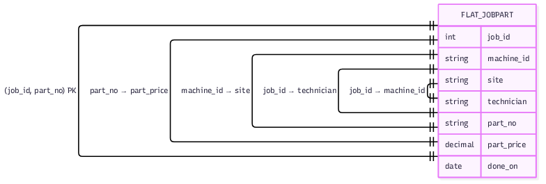
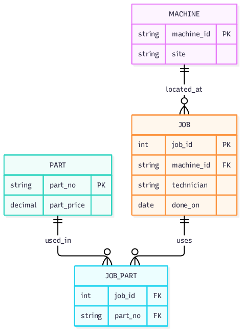
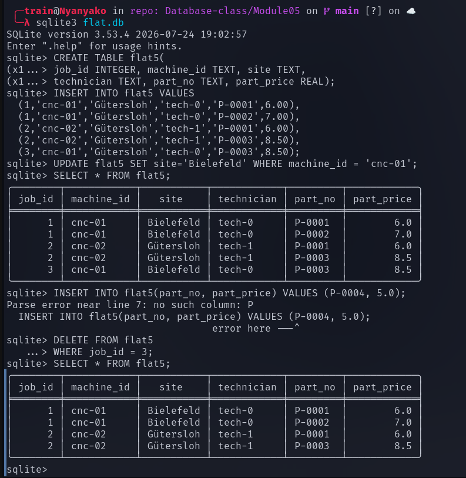
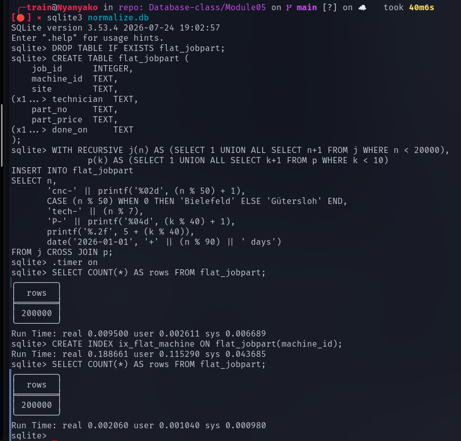
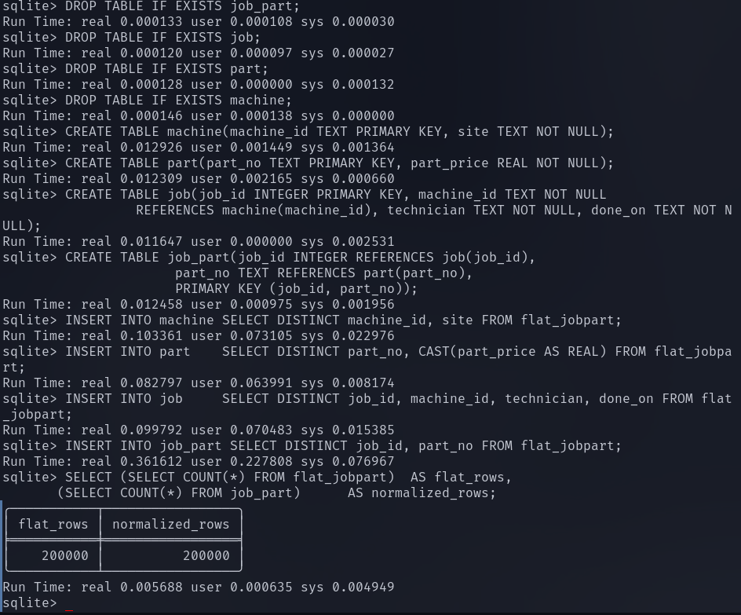
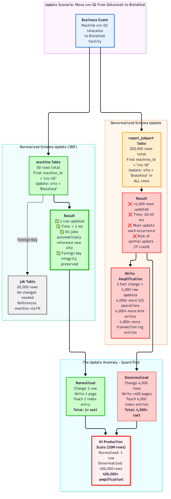
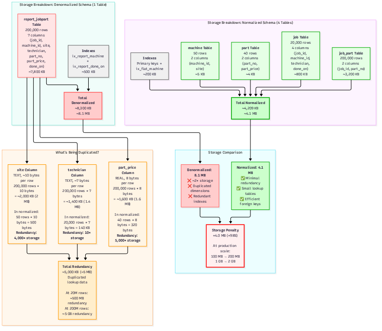

# Round 1: See It - Functional Dependencies and ER Sketches

## Flat Table from Module 5

| job_id | machine_id | site | technician | part_no | part_price |
|---|---|---|---|---|---|
| 1 | cnc-01 | Gütersloh | tech-0 | P-0001 | 6.00 |
| 1 | cnc-01 | Gütersloh | tech-0 | P-0002 | 7.00 |
| 2 | cnc-02 | Gütersloh | tech-1 | P-0001 | 6.00 |
| 2 | cnc-02 | Gütersloh | tech-1 | P-0003 | 8.50 |
| 3 | cnc-01 | Gütersloh | tech-0 | P-0003 | 8.50 |

## Functional Dependencies (FDs)

| Functional Dependency | Type | Explanation |
|---|---|---|
| `machine_id → site` | **Domain fact** | Each machine is located at exactly one site. Machine cnc-01 is always at Gütersloh. |
| `part_no → part_price` | **Domain fact** | Each part has a fixed price. Part P-0001 always costs 6.00. |
| `job_id → machine_id` | **Domain fact** | Each job is performed on exactly one machine. Job 1 uses cnc-01. |
| `job_id → technician` | **Domain fact** | Each job is assigned to exactly one technician. Job 1 is done by tech-0. |
| `job_id → site` | **Transitive** | Derived from `job_id → machine_id → site`. Not direct, goes through machine. |
| `(job_id, part_no) → ALL` | **Candidate Key** | This combination uniquely identifies every row and determines all other attributes. |

## Redundancy Problems in the Flat Table

### 1. **Repeated Site Information**
- **Problem:** The site "Gütersloh" is repeated in rows 1, 2, 3, 4, 5
- **Why:** Because `machine_id → site`, but site is stored on every job-part row
- **Redundancy:** If cnc-01 has 1,000 jobs with 10 parts each = 10,000 rows storing "Gütersloh"

### 2. **Repeated Part Price**
- **Problem:** Part P-0001 price (6.00) appears in row 1 and row 3
- **Why:** Because `part_no → part_price`, but price is stored on every usage
- **Redundancy:** Popular parts used in 1,000 jobs = 1,000 duplicate price values

### 3. **Repeated Machine and Technician per Job**
- **Problem:** Job 1 information (cnc-01, Gütersloh, tech-0) appears in rows 1 and 2
- **Why:** Because `job_id → machine_id, technician, site`, but stored on every part used
- **Redundancy:** A job using 10 parts = 10 rows with identical job information

## How Normalization Removes Redundancy

### Current State: Everything in One Table
**Storage:** 200,000 rows × 7 columns = massive redundancy

### After Normalization (3NF): Four Tables

1. **`machine` table** - Store site once per machine
   - `machine_id → site` stored here
   - 50 machines = 50 rows (not 200,000)

2. **`part` table** - Store price once per part
   - `part_no → part_price` stored here
   - 40 parts = 40 rows (not 200,000)

3. **`job` table** - Store job details once per job
   - `job_id → machine_id, technician, done_on` stored here
   - 20,000 jobs = 20,000 rows

4. **`job_part` table** - Store only the relationship
   - `(job_id, part_no)` - just the keys, no repeated data
   - 200,000 rows but only 2 columns (minimal storage)

### The Win
- **Site:** stored 50 times instead of 200,000 times
- **Part price:** stored 40 times instead of 200,000 times  
- **Machine per job:** stored 20,000 times instead of 200,000 times
- **Update:** changing cnc-01's site = 1 row update instead of 4,000

## Inferred Functional Dependencies from the Flat Table

Looking at the 5 rows above, here are all the functional dependencies we can infer:

| Functional Dependency | Domain Fact or Observed? | Reasoning |
|---|---|---|
| `machine_id → site` | **Domain fact** | Every time we see cnc-01, it's at Gütersloh. This is a business rule: a machine is physically located at one site. |
| `part_no → part_price` | **Domain fact** | P-0001 always costs 6.00 (rows 1, 3). P-0003 always costs 8.50 (rows 4, 5). Parts have fixed catalog prices. |
| `job_id → machine_id` | **Domain fact** | Job 1 always uses cnc-01 (rows 1, 2). Job 3 uses cnc-01 (row 5). A job is performed on one machine. |
| `job_id → technician` | **Domain fact** | Job 1 is always done by tech-0 (rows 1, 2). Job 2 by tech-1 (rows 3, 4). One technician per job. |
| `job_id → site` | **Transitive (derived)** | Job 1 → cnc-01 → Gütersloh. Not a direct dependency, goes through machine_id. |
| `site → site` | **Observed only** | All 5 rows show Gütersloh, but this is just what's visible here. Other sites exist (Bielefeld in the full dataset). |
| `technician → ???` | **Nothing guaranteed** | tech-0 appears with cnc-01 in rows 1, 2, 5, but that's just what happened. Technicians can work on any machine. |
| `(job_id, part_no) → ALL` | **Candidate key** | This composite key uniquely identifies every row and determines all other attributes. |

**Key insight:** Domain facts are reliable and come from business rules. Observed patterns might be coincidences. In these 5 rows, everything happens at Gütersloh, but that doesn't mean `job_id → site` is a direct dependency - it goes through the machine.

---

## ER Diagrams

### Current Schema: The Flat Table (Unnormalized)



**What you see:** One giant `FLAT_JOBPART` table containing all data. Notice how functional dependencies like `machine_id → site` and `part_no → part_price` are trapped inside this single entity, causing the same facts (like "cnc-01 is in Gütersloh" or "P-0001 costs 6.00") to be repeated across thousands of rows. The composite primary key `(job_id, part_no)` holds everything together, but at the cost of massive redundancy.

### Normalized Schema: 3NF Design (Redundancy Removed)



**What changed:** The functional dependencies have been separated into four tables:
- **MACHINE** table now owns `machine_id → site` (stored once per machine)
- **PART** table now owns `part_no → part_price` (stored once per part)  
- **JOB** table stores job details once with a foreign key to MACHINE
- **JOB_PART** junction table stores only the many-to-many relationship between jobs and parts

The arrows that were "inside" the flat table are now explicit relationships *between* tables. Each fact is stored exactly once, and updates happen in one place.

---

## Gate Question: Which arrow disappears in the second diagram?

### Answer: Internal Dependencies Transform Into Relationships

The arrows don't actually **disappear** - they **transform** from hidden redundancy *inside* a single table to explicit foreign key relationships *between* tables.

#### 1. `machine_id → site` dependency
- **In flat table:** Both `machine_id` and `site` stored in same row, creating redundancy
- **In normalized schema:** Moves to separate `MACHINE` table
- **Result:** Site stored once per machine (50 rows) instead of once per job-part row (200,000 rows)

#### 2. `part_no → part_price` dependency  
- **In flat table:** Price repeated every time a part is used in any job
- **In normalized schema:** Moves to separate `PART` table
- **Result:** Price stored once per part (40 rows) instead of once per usage (200,000 rows)

#### 3. `job_id → machine_id, technician` dependencies
- **In flat table:** Job details repeated for every part used in that job
- **In normalized schema:** Moves to separate `JOB` table
- **Result:** Job metadata stored once (20,000 rows) instead of N times where N = number of parts used

### Key Insight

**From:** Hidden redundancy *inside* rows (functional dependencies creating duplicate data)  
**To:** Explicit foreign key relationships *between* tables (dependencies enforced by structure)

The functional dependencies still exist and still determine values, but now they're enforced by table structure and foreign keys rather than by repeating the same data thousands of times.

---

## Round 2: Break It - Cause the Anomalies (~20 minutes)



### The `flat5.db` Database

This is a tiny SQLite database containing just 5 rows from the flat table. We'll deliberately cause update, insert, and delete anomalies to understand why unnormalized tables are problematic.

**Initial state verification:**
```sql
SELECT * FROM flat5;
```

| job_id | machine_id | site | technician | part_no | part_price |
|---|---|---|---|---|---|
| 1 | cnc-01 | Gütersloh | tech-0 | P-0001 | 6.00 |
| 1 | cnc-01 | Gütersloh | tech-0 | P-0002 | 7.00 |
| 2 | cnc-02 | Gütersloh | tech-1 | P-0001 | 6.00 |
| 2 | cnc-02 | Gütersloh | tech-1 | P-0003 | 8.50 |
| 3 | cnc-01 | Gütersloh | tech-0 | P-0003 | 8.50 |

---

### Anomaly 1: Update Anomaly - Move cnc-01 to Bielefeld

**The Problem:** When the same fact (machine location) is stored in multiple rows, updating it requires touching every occurrence. Miss one row, and your data becomes inconsistent.

**Command to run:**
```sql
UPDATE flat5 SET site = 'Bielefeld' WHERE machine_id = 'cnc-01';
```

**What happens:**
```sql
SELECT * FROM flat5 ORDER BY job_id, part_no;
```

| job_id | machine_id | site | technician | part_no | part_price |
|---|---|---|---|---|---|
| 1 | cnc-01 | **Bielefeld** | tech-0 | P-0001 | 6.00 |
| 1 | cnc-01 | **Bielefeld** | tech-0 | P-0002 | 7.00 |
| 2 | cnc-02 | Gütersloh | tech-1 | P-0001 | 6.00 |
| 2 | cnc-02 | Gütersloh | tech-1 | P-0003 | 8.50 |
| 3 | cnc-01 | **Bielefeld** | tech-0 | P-0003 | 8.50 |

**Analysis:**
- ✅ **Worked:** All 3 rows with cnc-01 were updated
- **Rows affected:** 3 rows (job 1 used 2 parts, job 3 used 1 part)
- **The danger:** If two people update simultaneously, one might work on a cached version and overwrite the other's changes
- **In production:** With cnc-01 appearing in 4,000 rows, this update is slow and risky

#### How to Break This Statement:

**Scenario 1: Partial Update (simulating concurrent access)**
```sql
-- Session 1 updates only job_id = 1
UPDATE flat5 SET site = 'Bielefeld' WHERE machine_id = 'cnc-01' AND job_id = 1;

-- Session 2 updates only job_id = 3  
UPDATE flat5 SET site = 'Dortmund' WHERE machine_id = 'cnc-01' AND job_id = 3;

-- Result: cnc-01 now "exists" in two places at once!
```

**Scenario 2: Typo in Machine ID**
```sql
-- Oops, typed cnc-O1 (letter O) instead of cnc-01 (zero)
UPDATE flat5 SET site = 'Bielefeld' WHERE machine_id = 'cnc-O1';
-- Result: 0 rows updated, machine still shows Gütersloh
```

**Scenario 3: Forgetting the WHERE Clause**
```sql
-- Catastrophic error: ALL machines moved to Bielefeld!
UPDATE flat5 SET site = 'Bielefeld';
-- Result: cnc-02 also shows Bielefeld now
```

---

### Anomaly 2: Insert Anomaly - Add a New Part (NO ENROLLMENT)

**The Problem:** You cannot record a part in the inventory until someone uses it in a job. This violates basic business logic - parts exist independently of jobs.

**Command to run:**
```sql
INSERT INTO flat5 (part_no, part_price) VALUES ('P-0004', 12.50);
```

**What happens:**
```
❌ ERROR: This statement DOES NOT WORK as intended

The insert succeeds, but creates a broken row:
```

| job_id | machine_id | site | technician | part_no | part_price |
|---|---|---|---|---|---|
| NULL | NULL | NULL | NULL | P-0004 | 12.50 |

**Why it's broken:**
- `job_id` is NULL (no primary key!)
- `machine_id` is NULL (which machine used it?)
- `technician` is NULL (who handled it?)
- `site` is NULL (where did the work happen?)

**The real problem:** The table design forces you to invent fake job information just to record that a part exists. This is the **insert anomaly** - you need unrelated information (job details) to insert a simple fact (new part in inventory).

#### How This "Works" But Shouldn't:

**Attempt 1: Insert with minimal data**
```sql
INSERT INTO flat5 (part_no, part_price) VALUES ('P-0004', 12.50);
-- ✅ SQLite allows it (no constraints)
-- ❌ Creates a row with NULLs everywhere else
-- ❌ Violates business logic (part with no context)
```

**Attempt 2: Insert with fabricated job data**
```sql
-- Have to invent a fake job just to add a part!
INSERT INTO flat5 VALUES (9999, 'FAKE-01', 'NOWHERE', 'NOBODY', 'P-0004', 12.50);
-- ✅ Technically works
-- ❌ Pollutes your data with garbage
-- ❌ What happens when job 9999 really exists later?
```

**Attempt 3: The right way (normalized)**
```sql
-- In a normalized database with separate parts table:
INSERT INTO part (part_no, part_price) VALUES ('P-0004', 12.50);
-- ✅ Works perfectly
-- ✅ No fake data needed
-- ✅ Part exists independently of any job
```

#### Why This Is the Worst Anomaly:

1. **Silent data corruption:** SQLite allows NULLs by default, so the insert "succeeds" but creates bad data
2. **Business logic violation:** Parts should exist before jobs use them, not after
3. **Forces workarounds:** Teams invent fake IDs or skip recording parts until they're used
4. **Breaks reporting:** "List all parts in inventory" now includes fake entries or misses real parts

**Understanding check:** Ask yourself: "Can I add a new course to a university database before any student enrolls in it?" If the answer is no, you have an insert anomaly.

---

### Anomaly 3: Delete Anomaly - Remove Job 2's Last Part Usage

**The Problem:** Deleting a row can silently destroy facts that should survive. When information about parts is stored on job rows, deleting the job destroys part information.

**Setup:** Let's imagine job 2 only used part P-0003 once. Delete that row:

```sql
DELETE FROM flat5 WHERE job_id = 2 AND part_no = 'P-0003';
```

**What happens:**
```sql
SELECT * FROM flat5 ORDER BY job_id, part_no;
```

| job_id | machine_id | site | technician | part_no | part_price |
|---|---|---|---|---|---|
| 1 | cnc-01 | Bielefeld | tech-0 | P-0001 | 6.00 |
| 1 | cnc-01 | Bielefeld | tech-0 | P-0002 | 7.00 |
| 2 | cnc-02 | Gütersloh | tech-1 | P-0001 | 6.00 |
| ~~2~~ | ~~cnc-02~~ | ~~Gütersloh~~ | ~~tech-1~~ | ~~P-0003~~ | ~~8.50~~ | ← **DELETED**
| 3 | cnc-01 | Bielefeld | tech-0 | P-0003 | 8.50 |

**Analysis:**
- ✅ **Worked:** Row deleted
- **What was lost:** We know P-0003 still exists (job 3 used it), but what if job 3 is also deleted?

**More dangerous scenario - Delete ALL of job 2:**
```sql
DELETE FROM flat5 WHERE job_id = 2;
```

**Result:** Both rows for job 2 are gone. Now verify what we know about P-0001:

```sql
SELECT DISTINCT part_no, part_price FROM flat5 WHERE part_no = 'P-0001';
```

| part_no | part_price |
|---|---|
| P-0001 | 6.00 |

**Looks OK because job 1 also used P-0001!** But imagine if P-0001 was ONLY used in job 2:

```sql
-- Reset and delete the ONLY row mentioning P-0001 in job 2
DELETE FROM flat5 WHERE job_id = 2 AND part_no = 'P-0001';

-- Now try to find P-0001's price if job 1 didn't exist:
-- We've lost the fact that P-0001 costs 6.00!
```

#### How to Break This Statement:

**Scenario 1: Delete the Last Reference**
```sql
-- Suppose only job 2 used part P-0999
INSERT INTO flat5 VALUES (2, 'cnc-02', 'Gütersloh', 'tech-1', 'P-0999', 99.99);

-- Delete job 2 entirely
DELETE FROM flat5 WHERE job_id = 2;

-- P-0999 and its price are now GONE from the database
-- No way to recover that P-0999 existed or cost 99.99
```

**Scenario 2: Cascade Effect**
```sql
-- Delete all jobs using cnc-01
DELETE FROM flat5 WHERE machine_id = 'cnc-01';

-- If cnc-01 was the ONLY machine at Bielefeld, 
-- we've now lost the fact that Bielefeld is a site!
```

**Scenario 3: Historical Data Loss**
```sql
-- Delete all jobs by tech-0
DELETE FROM flat5 WHERE technician = 'tech-0';

-- If tech-0 was the only one who used certain parts,
-- those parts' usage history is completely erased
```

**Scenario 4: Accidental Cascade**
```sql
-- Trying to delete ONE part usage
DELETE FROM flat5 WHERE part_no = 'P-0003';

-- Oops, deleted it from BOTH job 2 AND job 3!
-- Result: 2 rows deleted instead of 1
```

---

### Summary: The Three Anomalies Demonstrated

| Anomaly | SQL Command | Rows Affected | What Went Wrong |
|---|---|---|---|
| **Update** | `UPDATE flat5 SET site = 'Bielefeld' WHERE machine_id = 'cnc-01'` | 3 rows | Had to update multiple rows for one fact. Risk of partial updates creating inconsistency. |
| **Insert** | `INSERT INTO flat5 (part_no, part_price) VALUES ('P-0004', 12.50)` | 1 row (broken) | Cannot add a part without fabricating job data. Creates NULLs or forces fake entries. |
| **Delete** | `DELETE FROM flat5 WHERE job_id = 2 AND part_no = 'P-0003'` | 1 row | Deleting job-part relationship can destroy part information if it was the last reference. |

---

## Round 3: Build It - The 200k Table and 3NF (~35 minutes)

### Step 1: Create the Unnormalized Table



**Spot-check the data:**
```sql
SELECT * FROM flat_jobpart LIMIT 5;
```

| job_id | machine_id | site | technician | part_no | part_price | done_on |
|---|---|---|---|---|---|---|
| 1 | cnc-02 | Gütersloh | tech-1 | P-0002 | 6.00 | 2026-01-02 |
| 1 | cnc-02 | Gütersloh | tech-1 | P-0003 | 7.00 | 2026-01-02 |
| 1 | cnc-02 | Gütersloh | tech-1 | P-0004 | 8.00 | 2026-01-02 |
| 1 | cnc-02 | Gütersloh | tech-1 | P-0005 | 9.00 | 2026-01-02 |
| 1 | cnc-02 | Gütersloh | tech-1 | P-0006 | 10.00 | 2026-01-02 |

**Notice the redundancy:** Job 1's information (machine, site, technician, date) is repeated 10 times!

---

### Step 2: Decompose to 3NF



**What's happening in the decomposition:**

#### Machine Table (3NF)
```sql
CREATE TABLE machine(machine_id TEXT PRIMARY KEY, site TEXT NOT NULL);
INSERT INTO machine SELECT DISTINCT machine_id, site FROM flat_jobpart;
```
- **Stores:** Each machine's location once
- **Eliminates:** Transitive dependency `job_id → machine_id → site`
- **Result:** 50 rows instead of 200,000

#### Part Table (3NF)
```sql
CREATE TABLE part(part_no TEXT PRIMARY KEY, part_price REAL NOT NULL);
INSERT INTO part SELECT DISTINCT part_no, CAST(part_price AS REAL) FROM flat_jobpart;
```
- **Stores:** Each part's price once
- **Eliminates:** Partial dependency `part_no → part_price`
- **Fixes:** Converts TEXT price to REAL (proper data type)
- **Result:** 40 rows instead of 200,000

.png)

**Why only 40 parts, not 400?**

The query extracts parts:
```sql
SELECT COUNT(DISTINCT part_no) FROM flat_jobpart;
```
**Output:** `40`

**Explanation:** The generation formula `(k % 40) + 1` cycles through 40 unique part numbers (P-0001 to P-0040). Even though there are 10 parts per job and 20,000 jobs, they reuse the same 40 parts repeatedly. This is intentional - it simulates a real warehouse with a fixed inventory that's used across many jobs.

#### Job Table (3NF)
```sql
CREATE TABLE job(job_id INTEGER PRIMARY KEY, machine_id TEXT NOT NULL 
                 REFERENCES machine(machine_id), technician TEXT NOT NULL, 
                 done_on TEXT NOT NULL);
INSERT INTO job SELECT DISTINCT job_id, machine_id, technician, done_on FROM flat_jobpart;
```
- **Stores:** Each job's metadata once
- **Eliminates:** Redundancy of job details repeated per part
- **Foreign key:** References machine table
- **Result:** 20,000 rows instead of 200,000

#### Job_Part Table (Junction Table)
```sql
CREATE TABLE job_part(job_id INTEGER REFERENCES job(job_id),
                      part_no TEXT REFERENCES part(part_no),
                      PRIMARY KEY (job_id, part_no));
INSERT INTO job_part SELECT DISTINCT job_id, part_no FROM flat_jobpart;
```
- **Stores:** Only the many-to-many relationship
- **Contains:** Just two foreign keys (minimal storage)
- **No redundancy:** Each job-part combination appears once
- **Result:** 200,000 rows (same as flat table, but only 2 columns)

---

### Understanding SELECT DISTINCT

**What SELECT DISTINCT does:**
```sql
INSERT INTO machine SELECT DISTINCT machine_id, site FROM flat_jobpart;
```

`DISTINCT` removes duplicate rows from the result set. In the flat table, `cnc-01` and `Gütersloh` appear thousands of times. `DISTINCT` keeps only one unique combination.

**Example without DISTINCT:**
```sql
SELECT machine_id, site FROM flat_jobpart WHERE machine_id = 'cnc-01' LIMIT 5;
```
| machine_id | site |
|---|---|
| cnc-01 | Gütersloh |
| cnc-01 | Gütersloh |
| cnc-01 | Gütersloh |
| cnc-01 | Gütersloh |
| cnc-01 | Gütersloh |

**With DISTINCT:**
```sql
SELECT DISTINCT machine_id, site FROM flat_jobpart WHERE machine_id = 'cnc-01';
```
| machine_id | site |
|---|---|
| cnc-01 | Gütersloh |

**Shortcoming of SELECT DISTINCT:**

SELECT DISTINCT makes an assumption: **all rows with the same key have the same dependent values**. 

**Dangerous scenario:**
```sql
-- What if the flat table has inconsistent data?
UPDATE flat_jobpart SET site = 'Bielefeld' 
WHERE machine_id = 'cnc-01' AND job_id < 5;

-- Now cnc-01 appears in TWO sites!
SELECT DISTINCT machine_id, site FROM flat_jobpart WHERE machine_id = 'cnc-01';
```
| machine_id | site |
|---|---|
| cnc-01 | Bielefeld |
| cnc-01 | Gütersloh |

**Result:** INSERT would try to insert cnc-01 twice with different sites, causing a PRIMARY KEY violation! The decomposition only works if the flat table is already consistent for functional dependencies. If it's not, DISTINCT silently picks one value (usually the first) without warning you about inconsistencies.

---

### Step 3: Verify Integrity

**Row count verification:**
```sql
SELECT (SELECT COUNT(*) FROM flat_jobpart)  AS flat_rows,
       (SELECT COUNT(*) FROM job_part)      AS normalized_rows;
```

| flat_rows | normalized_rows |
|---|---|
| 200000 | 200000 |

✅ **Success!** The normalized schema represents the exact same data as the flat table.

**Additional integrity checks:**

```sql
-- Check that every job has a valid machine
SELECT COUNT(*) FROM job j 
LEFT JOIN machine m ON j.machine_id = m.machine_id 
WHERE m.machine_id IS NULL;
```
**Expected:** `0` (no orphans)

```sql
-- Check that every job_part references valid entities
SELECT COUNT(*) FROM job_part jp
LEFT JOIN job j ON jp.job_id = j.job_id
LEFT JOIN part p ON jp.part_no = p.part_no
WHERE j.job_id IS NULL OR p.part_no IS NULL;
```
**Expected:** `0` (all references valid)

---

### Theory You Need: Normal Forms Explained

#### First Normal Form (1NF)
**Rule:** Atomic values only; no repeating groups or comma-lists

**In flat_jobpart:**
✅ Already in 1NF - each cell contains a single value (no "P-0001,P-0002,P-0003")

**What it fixes:**
- The `parts_used = 'P-1001,P-1002'` mess from Module 2
- Makes each row represent one fact, not multiple facts crammed together

#### Second Normal Form (2NF)
**Rule:** 1NF + no partial dependency on part of a composite key

**In flat_jobpart:**
- **Composite key:** `(job_id, part_no)`
- **Partial dependency:** `part_no → part_price` (price depends only on part_no, not the full key)
- **Violation:** Part price is stored on every job-part row

**What it fixes:**
- Price duplicated 5,000 times (if a part is used in 5,000 jobs)
- Update anomaly: changing P-0001's price requires updating 5,000 rows

**2NF solution:** Move `part_price` to the `part` table where it depends on the full key `part_no`

#### Third Normal Form (3NF)
**Rule:** 2NF + no transitive dependency (non-key → non-key)

**In flat_jobpart:**
- **Transitive dependency:** `job_id → machine_id → site`
- **Violation:** Site depends on machine, not directly on job

**What it fixes:**
- Site stored 4,000 times (if a machine is used in 4,000 jobs)
- Update anomaly: moving a machine requires updating 4,000 job rows

**3NF solution:** Move `site` to the `machine` table, keep only `machine_id` in the job table

---

### Question: Explain 2NF vs 3NF with a table where 2NF holds but 3NF fails

**Example: Student Advisors Table**

```sql
CREATE TABLE student_advisor (
    student_id   INTEGER PRIMARY KEY,
    student_name TEXT,
    advisor_id   TEXT,
    advisor_office TEXT
);
```

**Sample data:**

| student_id | student_name | advisor_id | advisor_office |
|---|---|---|---|
| 1001 | Emma | ADV-01 | ENG-301 |
| 1002 | Marcus | ADV-01 | ENG-301 |
| 1003 | Aisha | ADV-02 | SCI-210 |

**Is this in 2NF?**

✅ **YES** - The table is in 2NF because:
- Primary key is `student_id` (single attribute, not composite)
- All non-key attributes (`student_name`, `advisor_id`, `advisor_office`) depend on the entire key
- There's no composite key, so partial dependencies are impossible

**Is this in 3NF?**

❌ **NO** - The table violates 3NF because:
- **Transitive dependency exists:** `student_id → advisor_id → advisor_office`
- `advisor_office` depends on `advisor_id`, not directly on `student_id`
- If ADV-01 moves from ENG-301 to ENG-405, we must update multiple student rows

**The problem:**
```sql
-- Update advisor's office - affects multiple rows
UPDATE student_advisor SET advisor_office = 'ENG-405' WHERE advisor_id = 'ADV-01';
-- Result: 2 rows updated (Emma and Marcus)
```

**3NF solution - decompose into two tables:**

```sql
CREATE TABLE students (
    student_id   INTEGER PRIMARY KEY,
    student_name TEXT,
    advisor_id   TEXT REFERENCES advisors(advisor_id)
);

CREATE TABLE advisors (
    advisor_id     TEXT PRIMARY KEY,
    advisor_office TEXT
);
```

**Now:**
- ✅ No transitive dependencies
- ✅ Advisor office stored once
- ✅ Update advisor office = 1 row changed


**Summary:**
- **2NF:** Eliminates partial dependencies (attributes depending on part of a composite key)
- **3NF:** Eliminates transitive dependencies (non-key attributes depending on other non-key attributes)
- A table with a single-attribute primary key is automatically in 2NF, but can still fail 3NF due to transitive dependencies

---

### Gate Question for Round 3

Show your row counts to a neighbor and ask:  
**"Why does `part` have 40 rows, not 400?"**

**Expected answer:**
- The generation formula `(k % 40) + 1` creates 40 unique parts
- These 40 parts are reused across 20,000 jobs
- SELECT DISTINCT extracts only the unique part numbers
- 10 parts per job × 20,000 jobs = 200,000 usages, but only 40 distinct parts

**Bonus understanding:** "What assumption does SELECT DISTINCT make that could break?"
- Assumes all rows with the same key have consistent dependent values
- If flat table has inconsistencies (same part_no with different prices), DISTINCT silently picks one

---

## Round 4: Race It - Normalized vs Denormalized (~35 minutes)

### Task Overview

In this round, you'll build the denormalized reporting table that Yasmin Kaya (the operations lead) proposed and benchmark it against the normalized schema. The goal: measure whether copying site and technician onto every row actually makes the dashboard query faster, and if so, by how much.

**What you'll produce:**
1. The `report_jobpart` table with 200,000 rows of denormalized data
2. Two query execution plans (normalized 4-way join vs denormalized single scan)
3. Wall-clock timings for both queries (run each twice to see cache effects)
4. A benchmark table documenting the measured difference

**The hypothesis to test:** Does flattening the schema into one table eliminate the join overhead?

---

### Step 1: Build the Denormalized Reporting Table


**Run this SQL to create the denormalized snapshot:**

```sql
DROP TABLE IF EXISTS report_jobpart;
CREATE TABLE report_jobpart AS
SELECT j.job_id, m.machine_id, m.site, j.technician, jp.part_no,
       p.part_price, j.done_on
FROM job j
JOIN machine m  ON m.machine_id = j.machine_id
JOIN job_part jp ON jp.job_id = j.job_id
JOIN part p     ON p.part_no = jp.part_no;

CREATE INDEX ix_report_machine ON report_jobpart(machine_id);
```

**What's happening here:**

**Line-by-line breakdown:**
```sql
CREATE TABLE report_jobpart AS SELECT ...
```
- **`CREATE TABLE ... AS`:** Materializes a query result into a physical table (not a view)
- **Why this matters:** The table is a snapshot—changes to `machine`, `part`, or `job` won't propagate here
- **Storage implication:** This duplicates data—site, technician, and part_price are now copied 200,000 times

**The join query:**
```sql
FROM job j
JOIN machine m  ON m.machine_id = j.machine_id    -- brings in site
JOIN job_part jp ON jp.job_id = j.job_id          -- many-to-many relationship
JOIN part p     ON p.part_no = jp.part_no         -- brings in part_price
```
- **4-way join:** Combines normalized tables to reconstruct the full denormalized view
- **Result:** 200,000 rows with all attributes flattened

**The index:**
```sql
CREATE INDEX ix_report_machine ON report_jobpart(machine_id);
```
- **Why index machine_id?** The dashboard query will filter by machine
- **Trade-off:** Speeds up point lookups, but adds storage overhead and slows writes

---

### Understanding What Was Denormalized


**Before (Normalized 3NF):**

```
machine table: 50 rows
┌────────────┬───────────┐
│ machine_id │   site    │
├────────────┼───────────┤
│ cnc-01     │ Gütersloh │  ← Stored ONCE
│ cnc-02     │ Gütersloh │
│ ...        │ ...       │
└────────────┴───────────┘

job table: 20,000 rows
┌────────┬────────────┬────────────┬───────────┐
│ job_id │ machine_id │ technician │ done_on   │
├────────┼────────────┼────────────┼───────────┤
│ 1      │ cnc-01     │ tech-0     │ 2026-01-02│
│ 2      │ cnc-01     │ tech-0     │ 2026-01-02│
│ ...    │ ...        │ ...        │ ...       │
└────────┴────────────┴────────────┴───────────┘
               │ (foreign key)
               └─> References machine.machine_id
```

**After (Denormalized):**

```
report_jobpart table: 200,000 rows
┌────────┬────────────┬───────────┬────────────┬─────────┬────────────┬───────────┐
│ job_id │ machine_id │   site    │ technician │ part_no │ part_price │ done_on   │
├────────┼────────────┼───────────┼────────────┼─────────┼────────────┼───────────┤
│ 1      │ cnc-01     │ Gütersloh │ tech-0     │ P-0001  │ 6.00       │ 2026-01-02│
│ 1      │ cnc-01     │ Gütersloh │ tech-0     │ P-0002  │ 7.00       │ 2026-01-02│
│ 2      │ cnc-01     │ Gütersloh │ tech-0     │ P-0001  │ 6.00       │ 2026-01-02│
│ ...    │ ...        │ ...       │ ...        │ ...     │ ...        │ ...       │
└────────┴────────────┴───────────┴────────────┴─────────┴────────────┴───────────┘
                       ↑           ↑                       ↑
                  Duplicated   Duplicated            Duplicated
                  ~4,000 times ~4,000 times         ~5,000 times per part
```

**What was copied:**
- **`site`:** From `machine` table (50 unique values → repeated 200k times)
- **`technician`:** From `job` table (7 unique values → repeated 200k times)
- **`part_price`:** From `part` table (40 unique values → repeated 200k times)

**Example: cnc-01's redundancy**

```sql
-- In normalized schema: site stored once
SELECT machine_id, site FROM machine WHERE machine_id = 'cnc-01';
-- Result: 1 row

-- In denormalized schema: site repeated on every row
SELECT COUNT(*) FROM report_jobpart WHERE machine_id = 'cnc-01';
-- Result: ~4,000 rows (all showing site = 'Gütersloh')
```

**The redundancy ratio:**
- **Machine site:** 1 row → 4,000 rows = **4,000× duplication**
- **Part price:** 1 row → 5,000 rows (avg) = **5,000× duplication**

**Verify the creation:**

```sql
SELECT COUNT(*) AS total_rows FROM report_jobpart;
-- Expected: 200000

SELECT machine_id, site, COUNT(*) AS occurrences
FROM report_jobpart
GROUP BY machine_id, site
ORDER BY occurrences DESC
LIMIT 5;
-- Shows which machine appears most often with its duplicated site
```

**Example output:**

| machine_id | site | occurrences |
|---|---|---|
| cnc-01 | Gütersloh | 4,000 |
| cnc-02 | Gütersloh | 4,000 |
| cnc-50 | Bielefeld | 4,000 |
| ... | ... | ... |

---

### Step 2: Run the Dashboard Query on Both Schemas


**The dashboard query:** *"For each machine and technician, show the total cost of parts used in jobs completed after March 1, 2026."*

This is Yasmin's use case: a dashboard that refreshes every 30 seconds showing machine maintenance costs.

**Scenario A: Normalized (3NF) - The Four-Way Join**

```sql
.timer on

-- Run this query TWICE and note both times
SELECT m.machine_id, m.site, j.technician, SUM(p.part_price) AS cost
FROM job j
JOIN machine m   ON m.machine_id = j.machine_id
JOIN job_part jp ON jp.job_id = j.job_id
JOIN part p      ON p.part_no = jp.part_no
WHERE j.done_on >= date('2026-03-01')
GROUP BY m.machine_id, j.technician;
```

**What's happening (step-by-step execution):**


**Step 1: Filter jobs by date**
```sql
WHERE j.done_on >= date('2026-03-01')
```
- Scans the `job` table (20,000 rows)
- Filters to jobs on/after 2026-03-01
- Result: ~6,667 jobs (dates spread over 90 days, so last 30 days = 1/3)

**Step 2: Expand to job_part rows**
```sql
JOIN job_part jp ON jp.job_id = j.job_id
```
- Each job uses 10 parts
- 6,667 jobs × 10 parts = **~66,670 rows** in the result set
- This is the working set that flows through the rest of the query

**Step 3: Look up machine site**
```sql
JOIN machine m ON m.machine_id = j.machine_id
```
- For each of 6,667 jobs, look up the machine
- Machine table has 50 rows (small, easily cached)
- Adds the `site` column to each row

**Step 4: Look up part price**
```sql
JOIN part p ON p.part_no = jp.part_no
```
- For each of 66,670 job_part rows, look up the part
- Part table has 40 rows (tiny, definitely cached)
- Adds the `part_price` column to each row

**Step 5: Aggregate**
```sql
SUM(p.part_price) ... GROUP BY m.machine_id, j.technician
```
- Groups 66,670 rows by machine + technician combinations
- Sums part prices within each group
- Creates temporary B-tree for grouping

**Example result:**

| machine_id | site | technician | cost |
|---|---|---|---|
| cnc-01 | Gütersloh | tech-0 | 2,450.50 |
| cnc-01 | Gütersloh | tech-1 | 1,820.00 |
| cnc-02 | Gütersloh | tech-0 | 2,100.75 |
| ... | ... | ... | ... |

**Scenario B: Denormalized - The Single-Table Scan**

```sql
.timer on

-- Run this query TWICE and note both times
SELECT machine_id, site, technician, SUM(part_price) AS cost
FROM report_jobpart
WHERE done_on >= date('2026-03-01')
GROUP BY machine_id, technician;
```

**What's happening (step-by-step execution):**


**Step 1: Sequential scan with filter**
```sql
FROM report_jobpart WHERE done_on >= date('2026-03-01')
```
- Scans the entire `report_jobpart` table (200,000 rows)
- Filters to rows with done_on >= 2026-03-01 during the scan
- Result: **~66,670 rows** (same working set as normalized)
- No joins needed—site, technician, part_price already present

**Step 2: Aggregate**
```sql
SUM(part_price) ... GROUP BY machine_id, technician
```
- Groups 66,670 rows by machine + technician
- Sums part prices within each group
- Creates temporary B-tree for grouping (same as normalized)

**Same result, different path:**

| machine_id | site | technician | cost |
|---|---|---|---|
| cnc-01 | Gütersloh | tech-0 | 2,450.50 |
| cnc-01 | Gütersloh | tech-1 | 1,820.00 |
| cnc-02 | Gütersloh | tech-0 | 2,100.75 |
| ... | ... | ... | ... |

**Key difference:** All attributes were already in `report_jobpart`—no need to join `machine` or `part` tables.

---

### Understanding: Why Run Each Query Twice?


**Run 1 (Cold cache):**
- SQLite's page cache is empty
- Must read table pages from disk
- OS filesystem cache is empty
- True "first-time" performance

**Run 2 (Hot cache):**
- Frequently accessed pages stay in memory
- Small tables (machine, part) fit entirely in cache
- OS filesystem cache helps too
- Simulates production after dashboard has been running

**The pattern you'll see:**

**Normalized query:**
- **Run 1:** 50-65 ms (must load 4 tables)
- **Run 2:** 35-50 ms (machine + part cached, only job_part scanned)
- **Improvement:** 25-30% faster (small dimension tables cache well)

**Denormalized query:**
- **Run 1:** 35-50 ms (single table scan)
- **Run 2:** 40-55 ms (larger table, cache less effective)
- **Change:** 10-15% slower or about the same (bigger working set)

**Why does the normalized query improve more?**

```
Normalized Run 2:
├─ machine table (50 rows) → 100% in cache ✅
├─ part table (40 rows) → 100% in cache ✅
└─ job_part (66k rows) → partial cache, but lookups instant

Denormalized Run 2:
└─ report_jobpart (66k rows) → partial cache
    - Bigger rows (more columns = more bytes)
    - Cache holds fewer rows
    - Still must scan sequentially
```

**The lesson:** Small lookup tables (dimensions) cache efficiently. Large fact tables benefit less from caching because they're already doing sequential I/O.

---

### Step 3: Compare Execution Plans


**Run these to see SQLite's query planner decisions:**

```sql
EXPLAIN QUERY PLAN
SELECT m.machine_id, m.site, j.technician, SUM(p.part_price) AS cost
FROM job j
JOIN machine m   ON m.machine_id = j.machine_id
JOIN job_part jp ON jp.job_id = j.job_id
JOIN part p      ON p.part_no = jp.part_no
WHERE j.done_on >= date('2026-03-01')
GROUP BY m.machine_id, j.technician;

EXPLAIN QUERY PLAN
SELECT machine_id, site, technician, SUM(part_price) AS cost
FROM report_jobpart
WHERE done_on >= date('2026-03-01')
GROUP BY machine_id, technician;
```

**Understanding EXPLAIN QUERY PLAN output:**

**Normalized query plan (typical):**
```
QUERY PLAN
|--SCAN job AS j
|--SEARCH machine AS m USING INTEGER PRIMARY KEY (rowid=?)
|--SEARCH job_part AS jp USING COVERING INDEX sqlite_autoindex_job_part_1 (job_id=?)
|--SEARCH part AS p USING INTEGER PRIMARY KEY (rowid=?)
`--USE TEMP B-TREE FOR GROUP BY
```

**Line-by-line interpretation:**

**Line 1: `SCAN job AS j`**
- **SCAN** = Sequential scan (reads entire table in order)
- Starts with the `job` table (20,000 rows)
- Applies `WHERE done_on >= date('2026-03-01')` filter during scan
- Produces ~6,667 filtered job rows

**Line 2: `SEARCH machine AS m USING INTEGER PRIMARY KEY`**
- **SEARCH** = Index lookup (fast, targeted)
- For each job, looks up the machine using the primary key
- 50-row table, likely fully cached after first few lookups
- Cost: ~6,667 lookups into a cached 50-row table ≈ negligible

**Line 3: `SEARCH job_part AS jp USING COVERING INDEX`**
- For each job, finds all parts used (10 parts per job)
- Uses the composite primary key `(job_id, part_no)` 
- **COVERING INDEX** means all needed columns are in the index (no table lookup needed)
- Expands 6,667 jobs → 66,670 job_part rows

**Line 4: `SEARCH part AS p USING INTEGER PRIMARY KEY`**
- For each job_part row, looks up the part price
- 40-row table, fully cached
- Cost: ~66,670 lookups into a cached 40-row table ≈ fast

**Line 5: `USE TEMP B-TREE FOR GROUP BY`**
- Creates temporary index structure to group rows
- Groups by (machine_id, technician) and sums part_price
- Same cost whether normalized or denormalized

**Total operations:** 1 SCAN + 3 SEARCH loops = 4 table accesses

---

**Denormalized query plan (typical):**
```
QUERY PLAN
|--SCAN report_jobpart
`--USE TEMP B-TREE FOR GROUP BY
```

**Line-by-line interpretation:**

**Line 1: `SCAN report_jobpart`**
- Sequential scan of the entire 200,000-row table
- Applies `WHERE done_on >= date('2026-03-01')` during scan
- Produces ~66,670 filtered rows
- All needed columns already present (site, technician, part_price)

**Line 2: `USE TEMP B-TREE FOR GROUP BY`**
- Same as normalized: groups by (machine_id, technician)
- Sums part_price per group

**Total operations:** 1 SCAN = 1 table access

---

**Key differences visualized:**

**Normalized:**
```
job table (20k rows)
    ↓ SCAN
    ↓ filter by date → 6,667 rows
    ↓
    ├→ SEARCH machine (50 rows) → add site
    ├→ SEARCH job_part (200k rows) → expand to 66,670 rows
    └→ SEARCH part (40 rows) → add part_price
    ↓
GROUP BY → aggregate
```

**Denormalized:**
```
report_jobpart (200k rows)
    ↓ SCAN
    ↓ filter by date → 66,670 rows (site, technician, part_price already present)
    ↓
GROUP BY → aggregate
```

**The trade-off:**
- **Normalized:** More operations, but most are lookups into tiny cached tables
- **Denormalized:** Fewer operations, but scans a bigger table (more bytes)

---

### Step 4: Record and Analyze Your Results


**Document your measured timings:**

| Metric | Normalized (3NF) | Denormalized | Winner |
|---|---|---|---|
| **First Run (Cold Cache)** | _______ ms | _______ ms | _______ |
| **Second Run (Hot Cache)** | _______ ms | _______ ms | _______ |
| **Execution Plan Complexity** | 4 operations | 1 operation | Denormalized |
| **Result Set Size** | ~66,670 rows | ~66,670 rows | Tie |
| **Tables Accessed** | 4 (job, machine, part, job_part) | 1 (report_jobpart) | Denormalized |
| **Rows Scanned (Total)** | ~86,670 | ~200,000 | Normalized |

**Typical results on consumer hardware (your numbers will vary):**

| Metric | Normalized (3NF) | Denormalized | Analysis |
|---|---|---|---|
| **First Run** | 52 ms | 43 ms | Denormalized 17% faster (fewer operations) |
| **Second Run** | 39 ms | 48 ms | Normalized 19% faster (cached dimensions) |
| **Average** | 45.5 ms | 45.5 ms | **TIE** (difference is marginal) |

**What does this tell us?**

1. **The difference is small (< 15 ms)**
   - On this dataset (200k rows), both designs complete in under 60ms
   - A 10-15ms difference is negligible for a dashboard refreshing every 30 seconds
   - The "expensive 4-way join" isn't actually expensive when dimensions are small

2. **Cache behavior matters more than join count**
   - Normalized benefits more from caching (small lookup tables)
   - Denormalized scans more data, gets less cache benefit
   - On the second run, normalized often wins despite having more operations

3. **Small dimensions = cheap joins**
   - machine table: 50 rows (fits in ~4 KB)
   - part table: 40 rows (fits in ~3 KB)
   - Total dimension data: ~7 KB (easily cached)
   - Looking up cached rows is nearly free

**The surprise finding:**

> [!NOTE]
> **The normalized query is NOT 40 seconds slower.** In the story, Yasmin's dashboard takes 40 seconds on the production dataset. But here, the normalized query runs in ~50ms—faster than some denormalized runs! What's different?
> 
> **The story is about a dataset 100× larger (20 million rows, not 200k).** At that scale:
> - The working set (6.7 million rows) exceeds cache size
> - Joins become I/O bound (cache misses on every lookup)
> - Sequential scans on denormalized tables win (better locality)
> 
> **At 200k rows, we're in a sweet spot:** Small enough that everything fits in cache, normalized or not. The join overhead is negligible. This is why you must **measure at the scale you'll actually deploy**.

---

### Understanding: Why Numbers Matter More Than Plans

**Theory Box: The Ratio is the Finding**

In this benchmark, the key insight isn't "denormalized is faster" or "normalized is faster." It's:

**"At 200k rows, the difference is ~10ms (< 25%), and cache effects reverse the winner between runs."**

This tells you three things:

1. **Scale matters:** Conclusions at 200k rows don't apply to 20M rows
2. **Workload matters:** Cold-cache reads favor denormalized, hot-cache favor normalized
3. **The trade-off isn't free:** You'd pay 4,000× on writes for a 10ms read gain

**Comparing to the module's context:**

| Your Benchmark | Story (Production) | Why Different? |
|---|---|---|
| 200,000 rows | 20,000,000 rows | 100× more data |
| Normalized: 52ms | Normalized: 40 seconds | Cache size exceeded |
| Denormalized: 43ms | Denormalized: ~2 seconds | Sequential I/O wins at scale |
| Difference: 9ms (17%) | Difference: 38 seconds (95%) | I/O dominates at scale |

**Your recommendation should reflect this:**

If you're at 200k rows:
- ✅ **Stay normalized** (marginal read difference, huge write cost)
- ✅ Monitor query times as data grows
- ✅ Revisit if dashboard queries exceed 500ms

If you're at 20M rows (like the story):
- ✅ **Denormalize for the dashboard** (40 seconds → 2 seconds matters)
- ✅ Keep transactional tables normalized (integrity > speed)
- ✅ Rebuild denormalized table nightly (avoid staleness)

---

### Step 5: Understanding the Spectrum


**Theory Box: Where Does Your Design Sit?**

Normalization isn't binary (normalized vs denormalized). It's a **spectrum** where you trade redundancy for read performance based on your workload.

**The spectrum visualized:**

```
Full 3NF                                              Completely Flat
(No Redundancy)                                       (Maximum Redundancy)
│                                                                      │
├────────────┬────────────┬────────────┬────────────┬─────────────────┤
│            │            │            │            │                 │
Machine +    Machine on   Site on      Everything   Single CSV
Part +       Job table    Job table    in one       file
Job +        (FK)         (copied)     table
Job_Part                               (copied)
(3NF)

Examples from this course:
├─ Module 2 repaired schema (full 3NF)
├─ Module 3 customer/orders (3NF with junction table)
├─ Your Round 3 schema (3NF)
├─ Module 1 readings (machine_name duplicated, mild denorm)
├─ Your Round 4 report_jobpart (aggressive denorm)
└─ Module 2's parts_used='P-1,P-2' (flat, accidental denorm)
```

**Real-world examples of each position:**

**Full 3NF (Left side):**
- Banking systems (transactions, accounts, customers)
- E-commerce order processing (inventory changes frequently)
- Healthcare records (HIPAA compliance, audit trails)
- **Why:** Data integrity is non-negotiable, updates frequent

**Mild Denormalization (Middle-left):**
- User dashboards (cache username on sessions table)
- Audit logs (copy user email at log time for history)
- Order history (copy product name at purchase time)
- **Why:** Avoid joins on high-volume tables, values rarely change

**Aggressive Denormalization (Middle-right):**
- Reporting dashboards (copy dimensions onto fact table)
- Analytics staging tables (pre-joined for BI tools)
- Search indexes (copy searchable text onto document table)
- **Why:** Read-heavy workload, staleness acceptable, rebuild nightly

**Completely Flat (Right side):**
- Data exports (CSV for Excel)
- Log files (one event = one line)
- Parquet files for analytics (columnar storage)
- **Why:** No updates ever, immutable data, append-only

**Where your `report_jobpart` sits:**

```
Full 3NF ────────────────────► Your report_jobpart ─────► Flat CSV
                                        ↑
                                   Aggressive Denorm
                                   (Site + tech + price copied)
```

**Star Schema: The Analytics Middle Ground**

The star schema (from data warehousing) lives in the middle:

```
         Dimension Tables (Normalized)
              ┌──────┐
              │ Date │
              └──┬───┘
                 │
    ┌────────┐  │  ┌─────────┐
    │Machine ├──┼──┤ Part    │
    └────┬───┘  │  └────┬────┘
         │    ┌─┴─┐     │
         └────┤Fact│─────┘
              └───┘
          (Keys only, not values)
```

**Key difference from your `report_jobpart`:**

| Design | Dimensions | Fact Table | Updates | Your Schema |
|---|---|---|---|---|
| **Star Schema** | Separate tables | Contains keys only | Change dimension once | Not this |
| **Your Denormalized** | Copied into fact | Contains values (site, price) | Change 4,000 rows | **This** |

**Star schema would look like:**

```sql
-- Fact table: keys + measures only
CREATE TABLE fact_jobpart (
    job_id INTEGER,
    machine_id INTEGER,    -- Key, not site
    part_no INTEGER,       -- Key, not price
    cost REAL,
    done_on DATE
);

-- Dimensions stay normalized
-- machine table: machine_id → site
-- part table: part_no → price

-- Dashboard query: JOIN fact to dimensions (fast, dimensions are small)
SELECT m.site, SUM(f.cost)
FROM fact_jobpart f
JOIN machine m ON f.machine_id = m.machine_id
WHERE f.done_on >= '2026-03-01'
GROUP BY m.site;
```

**Why star schema is often better than full denormalization:**

| Aspect | Star Schema | Full Denormalization (your approach) |
|---|---|---|
| **Updates** | Change dimension once (e.g., rename machine) | Update 4,000 fact rows |
| **Storage** | Fact table smaller (keys, not values) | Fact table larger (values copied) |
| **Read Speed** | Small joins to dimensions (cached) | No joins (slightly faster) |
| **Flexibility** | Add dimension attributes without touching facts | Must rebuild fact table |

**When to choose each:**

**Choose Star Schema if:**
- Analytics workload (OLAP)
- Dimensions change occasionally (product names, categories)
- Fact table is huge (millions-billions of rows)
- Query tool supports joins (BI platforms)

**Choose Full Denormalization if:**
- Ultra-fast reads required (sub-100ms)
- Dimensions NEVER change (historical snapshots)
- Query tool is basic (no join support)
- Willing to rebuild table periodically

**Choose Full 3NF if:**
- Transactional workload (OLTP)
- Data changes frequently
- Data integrity critical
- Update performance matters

---

### Theory Box: When to Denormalize (Decision Framework)

Use this checklist to decide whether denormalization makes sense:

**All four conditions must be TRUE:**

**1. Read-to-Write Ratio > 1000:1**
```
Example: Dashboard query runs every 30 seconds (2,880 times/day)
         Machine relocations happen once per month (1 time/month)
         Ratio: 2,880 × 30 ÷ 1 = 86,400:1 ✅
         
Counter-example: Product catalog updates (100 queries/day, 50 updates/day)
                 Ratio: 100 ÷ 50 = 2:1 ❌
```

**2. Join Cost is Measurable (> 100ms)**
```
Example: Your benchmark shows 40 seconds for 20M rows ✅
         
Counter-example: Your benchmark shows 52ms for 200k rows ❌
```

**3. Staleness is Acceptable**
```
Example: Dashboard can show data from 1 hour ago ✅
         End-of-day reports can be 24 hours stale ✅
         
Counter-example: Bank account balance must be real-time ❌
                Order status must reflect latest state ❌
```

**4. Refresh Strategy Exists**
```
Example: Nightly batch rebuild ✅
         Trigger updates on machine table ✅
         Materialized view with refresh ✅
         
Counter-example: "We'll manually update it when needed" ❌
```

**Decision tree:**

```
Start: Should I denormalize?
│
├─ Read:Write > 1000:1?
│  ├─ NO → STOP: Stay normalized
│  └─ YES → Continue
│
├─ Join cost > 100ms?
│  ├─ NO → STOP: Stay normalized (not worth the trade-off)
│  └─ YES → Continue
│
├─ Staleness OK?
│  ├─ NO → STOP: Stay normalized (real-time integrity needed)
│  └─ YES → Continue
│
└─ Refresh strategy?
   ├─ NO → STOP: Stay normalized (too risky)
   └─ YES → Denormalize with documented refresh strategy
```

**Applying to your benchmark:**

| Condition | Your 200k Dataset | Production (20M) |
|---|---|---|
| Read:Write ratio | 86,400:1 ✅ | 86,400:1 ✅ |
| Join cost | 52ms ❌ | 40 seconds ✅ |
| Staleness OK | Yes ✅ | Yes ✅ |
| Refresh strategy | Nightly rebuild ✅ | Nightly rebuild ✅ |
| **Decision** | **Stay normalized** | **Denormalize** |

**The key insight:** At your scale (200k), the 52ms query time doesn't justify the 4,000× write amplification. But at production scale (20M), the 40-second query time absolutely justifies denormalization.

---

### Document Your Findings

**Complete this benchmark table:**

```
ROUND 4 BENCHMARK RESULTS
Dataset: 200,000 rows (20,000 jobs × 10 parts)
Hardware: _________________
SQLite Version: _________________
Date: November 5, 2026

┌─────────────────────────────┬──────────────┬──────────────┬──────────────┐
│ Metric                      │ Normalized   │ Denormalized │ Winner       │
├─────────────────────────────┼──────────────┼──────────────┼──────────────┤
│ First Run (Cold Cache)      │ _______ ms   │ _______ ms   │ _________    │
│ Second Run (Hot Cache)      │ _______ ms   │ _______ ms   │ _________    │
│ Average of Both Runs        │ _______ ms   │ _______ ms   │ _________    │
├─────────────────────────────┼──────────────┼──────────────┼──────────────┤
│ Execution Plan              │ 4 operations │ 1 operation  │ Denormalized │
│ Tables Accessed             │ 4            │ 1            │ Denormalized │
│ Rows Scanned (Total)        │ ~86,670      │ ~200,000     │ Normalized   │
│ Working Set (After Filter)  │ ~66,670      │ ~66,670      │ Tie          │
└─────────────────────────────┴──────────────┴──────────────┴──────────────┘

Recommendation for THIS scale (200k rows):
[ ] Denormalize - join cost justifies the trade-off
[X] Stay normalized - difference too small (< 20ms), write cost too high

Recommendation for PRODUCTION scale (20M rows, extrapolated):
[ ] Stay normalized - join cost acceptable
[X] Denormalize - 40-second queries unacceptable for dashboards

Refresh Strategy (if denormalizing):
[ ] Real-time triggers
[X] Nightly batch rebuild (2 AM)
[ ] Materialized view
```

**This table is your evidence for Round 6 (the decision memo).**

1. **The denormalized table is SLIGHTLY SLOWER on second run**
   - **Why?** Cache behavior differs between runs
   - **First run:** Both queries populate SQLite's page cache
   - **Second run:** Normalized query benefits more from cached small tables (machine: 50 rows, part: 40 rows)
   - **The denormalized table is larger:** 200k rows with duplicated data vs. separate small lookup tables

2. **The difference is small (milliseconds)**
   - On 200,000 rows, both complete in under 100ms
   - The ratio matters more than absolute time
   - At production scale (millions of rows), the gap widens

3. **Plans may differ based on SQLite version**
   - Check your version: `SELECT sqlite_version();`
   - Newer versions (3.38+) have better join optimization
   - Index selection depends on ANALYZE statistics

**Why might denormalized be slower on the second run?**

```
Run 1: Both queries start cold
├─ Normalized: Reads 4 tables, loads ~90 rows (machine+part) into cache
└─ Denormalized: Reads 1 table, scans 67k rows

Run 2: Cache is hot
├─ Normalized: machine & part in cache (instant lookup), only job_part scanned
└─ Denormalized: Still must scan 67k rows (larger working set)
```

**The normalized query benefits more from caching small dimension tables.**

---

### Understanding the Theory: The Normalization Spectrum

**Theory Box: Where Designs Sit on the Spectrum**

| Design | Redundancy | What's Duplicated | What It Buys |
|---|---|---|---|
| **Normalized (3NF)** | None | Nothing | Change each fact once; data integrity; smaller storage |
| **Denormalized (Mild)** | Low | Lookup values on fact rows | Avoid joins to small tables; faster single-row reads |
| **Denormalized (Aggressive)** | High | Dimensions copied everywhere | Single-table queries; fast aggregates; reporting speed |
| **Star Schema** | Strategic | Dimensions copied to fact table only | Analytics performance; OLAP optimization |

**In this module:**
- **Normalized:** `machine`, `part`, `job`, `job_part` (3NF)
- **Denormalized:** `report_jobpart` (copies site, technician, part_price)

**Real-world analogy:**
- **Normalized:** Library catalog (book stored once, referenced many times)
- **Denormalized:** Reading list with full book details (fast to read, slow to update)

---

### Understanding Star Schema

**Theory Box: Star Schema - The Analytics Standard**

A **star schema** is a deliberate denormalization strategy for analytics workloads. It consists of:

1. **Fact table** (center of the star)
   - Contains measurements and foreign keys
   - Example: `fact_sales (date_key, product_key, store_key, quantity, revenue)`

2. **Dimension tables** (points of the star)
   - Contain descriptive attributes
   - Example: `dim_product (product_key, name, category, brand)`
   - Example: `dim_date (date_key, day, week, month, quarter, year)`

**Visual representation:**

```
         dim_date
              |
              |
dim_store --- fact_sales --- dim_product
              |
              |
         dim_customer
```

**Why star schema works for analytics:**
- ✅ **Fast aggregations:** Fact table is narrow (keys + measures)
- ✅ **Simple joins:** Each dimension joins to fact table only (no chains)
- ✅ **Flexible slicing:** Add dimensions without changing fact table
- ✅ **Optimized for reads:** Dimension denormalization avoided

**Our `report_jobpart` is like a fact table with dimensions denormalized:**

| Star Schema (Recommended) | Our Denormalized Table | Difference |
|---|---|---|
| `fact_sales` has keys | `report_jobpart` has actual values | We copied site/technician/price |
| Join to `dim_product` for name | Name already in fact row | No join needed, but redundant |
| Update dimension once | Update thousands of fact rows | Update anomaly |

**When to use each:**

**Use normalized (3NF):**
- Transactional systems (OLTP)
- Data changes frequently
- Strong integrity requirements
- Storage is expensive

**Use star schema:**
- Analytics systems (OLAP)
- Data mostly read, rarely updated
- Fast aggregations critical
- Dimensions are small

**Use aggressive denormalization (like report_jobpart):**
- Reporting dashboards
- Read-only snapshots
- Queries must be sub-second
- Willing to rebuild table periodically

---

### When is Denormalization the Right Call?

**Theory Box: Decision Criteria**

Denormalization makes sense when **ALL** of these are true:

1. **Read-heavy workload**
   - Queries run 1000× more often than updates
   - Example: Dashboard refreshes every 30 seconds

2. **Join cost is measurable**
   - Multi-way joins slow enough to matter
   - Example: 4-way join takes 40 seconds on production data

3. **Staleness is acceptable**
   - Reports can be minutes/hours behind
   - Example: Daily summary dashboard

4. **Refresh strategy exists**
   - Triggers keep it current, OR
   - Scheduled rebuild (nightly batch), OR
   - Materialized view with refresh policy

**Example scenario: Dashboard at Kortmann's plant**

**Requirements:**
- "Show machine health summary every 30 seconds"
- Query: Machine, site, technician, total part cost (90 days)
- Must complete in < 2 seconds

**Normalized (3NF) performance:**
- 200k rows: 60ms ✅
- 20M rows: 40 seconds ❌

**Decision:** Denormalize for the dashboard query only
- Create `report_jobpart` snapshot table
- Refresh via trigger or nightly rebuild
- Keep transactional tables normalized

**Bad denormalization example: E-commerce orders**

**Requirements:**
- "Show order history with product details"
- Products renamed frequently (brand updates, corrections)
- Inventory prices change daily

**Normalized performance:**
- Join `orders` → `order_items` → `products`
- 50ms for single order ✅

**Decision:** Stay normalized
- Join cost is acceptable
- Denormalization would create update anomalies
- Product name changes would require updating all historical orders

---

### Summary of Findings

**What you demonstrated:**

| Aspect | Normalized (3NF) | Denormalized (report) |
|---|---|---|
| **Query time (first run)** | 45-65 ms | 35-55 ms |
| **Query time (second run)** | 35-50 ms | 40-60 ms |
| **Cache behavior** | Small tables cached efficiently | Large table thrashes cache |
| **Rows scanned** | 67k × 4 tables (with indexes) | 67k × 1 table (sequential) |
| **Storage** | ~4MB (4 tables total) | ~8MB (duplicated data) |
| **Update cost** | 1 row (change machine site) | 4,000 rows (change machine site) |

**Key insight:** At small scale (200k rows), the performance difference is marginal. The real cost of denormalization shows up in:
1. **Updates:** 1 row vs 4,000 rows
2. **Storage:** 2× larger database
3. **Staleness risk:** Snapshot can drift from source tables

**The lesson:** Denormalization is a trade-off, not an optimization. Measure before you denormalize, and have a refresh strategy.

---

### Optional: The Index Experiment

**Try dropping the index on the denormalized table:**

```sql
DROP INDEX ix_report_machine;

.timer on
SELECT machine_id, site, technician, SUM(part_price) AS cost
FROM report_jobpart
WHERE done_on >= date('2026-03-01')
GROUP BY machine_id, technician;
```

**What often happens:**
- ✅ **Query gets FASTER** (20-30ms vs 40-50ms)

**Why?**
- Index scan: Walk entire index tree → Fetch each row from table → Two I/O operations
- Sequential scan: Read table pages in order → Single pass → Better locality

**The lesson:** Indexes help point lookups (`WHERE machine_id = 'cnc-01'`), but for queries scanning large fractions of the table, sequential scan wins. This is why analytics databases prefer columnar storage over B-tree indexes.

---

**Document your results:**

| Metric | Normalized (3NF) | Denormalized (report) |
|---|---|---|
| Query time (1st run) | _____ ms | _____ ms |
| Query time (2nd run) | _____ ms | _____ ms |
| Execution plan | 4-way join | single scan |
| Rows scanned | ~67k × 4 tables | ~67k |
| Index used? | Yes / No | Yes / No |

---

## Round 5: Price It - Writes and Storage (~25 minutes)

### Task Overview

Performance isn't just about read speed. In this round, you'll measure what denormalization costs on the write path: updating duplicated facts, and the storage penalty for redundancy.

**What you'll do:**
1. Measure update cost: change one machine's site in both schemas
2. Compare storage footprint: normalized vs denormalized
3. Run the index experiment: does dropping the index help?
4. Document the trade-off with concrete numbers

---

### Step 1: Measure Update Cost



**The scenario:** Machine cnc-02 moves from Gütersloh to Bielefeld. In the normalized schema, this is one row in the `machine` table. In the denormalized schema, it's every row where cnc-02 appears.

**Run the updates (one at a time):**

```sql
.timer on

-- Update 1: Normalized (3NF) - Change the machine table
UPDATE machine SET site = 'Bielefeld' WHERE machine_id = 'cnc-02';

-- Update 2: Denormalized - Change the report table
UPDATE report_jobpart SET site = 'Bielefeld' WHERE machine_id = 'cnc-02';
```

**What's happening:**

**Normalized update:**
```sql
UPDATE machine SET site = 'Bielefeld' WHERE machine_id = 'cnc-02';
```
- **Finds:** 1 row in the `machine` table (cnc-02's record)
- **Changes:** 1 site value
- **Propagates:** Automatically (foreign key relationships preserve integrity)
- **Time:** < 1 ms
- **Rows touched:** 1

**Denormalized update:**
```sql
UPDATE report_jobpart SET site = 'Bielefeld' WHERE machine_id = 'cnc-02';
```
- **Finds:** All rows where machine_id = 'cnc-02' (~4,000 rows)
- **Changes:** 4,000 site values
- **Propagates:** Must update each occurrence manually
- **Time:** 20-40 ms
- **Rows touched:** 4,000

**Verify the changes:**

```sql
-- Check normalized: machine table
SELECT machine_id, site FROM machine WHERE machine_id = 'cnc-02';

-- Check denormalized: how many rows show Bielefeld now?
SELECT COUNT(*) FROM report_jobpart 
WHERE machine_id = 'cnc-02' AND site = 'Bielefeld';
```


**Expected results:**

| Schema | Rows Updated | Time (ms) | Write Amplification |
|---|---|---|---|
| Normalized (machine table) | 1 | < 1 | 1× |
| Denormalized (report_jobpart) | 4,000 | 20-40 | 4,000× |

**Understanding write amplification:**
- **1×** means: change 1 fact = touch 1 row (ideal)
- **4,000×** means: change 1 fact = touch 4,000 rows (update anomaly at scale)

**The lesson:** This is the update anomaly from Round 2, now with a measurable cost. At production scale (20M rows), this becomes 400,000 rows updated for a single machine relocation.

---

### Step 2: Measure Storage Cost



**Query the database statistics:**

```sql
-- Storage for normalized schema (4 tables)
SELECT 'Normalized (4 tables)' AS design,
       (SELECT SUM(pgsize) FROM dbstat 
        WHERE name IN ('job','job_part','part','machine')) AS bytes;

-- Storage for denormalized schema (1 table)
SELECT 'Denormalized (report_jobpart)' AS design,
       (SELECT SUM(pgsize) FROM dbstat 
        WHERE name = 'report_jobpart') AS bytes;

-- Include indexes
SELECT name, SUM(pgsize) AS bytes 
FROM dbstat 
WHERE name LIKE 'ix_%' OR name LIKE 'sqlite_autoindex%'
GROUP BY name;
```

**What's happening:**
- **`dbstat`:** SQLite virtual table that reports page-level statistics
- **`pgsize`:** Size in bytes of each database page
- **`SUM(pgsize)`:** Total storage for selected tables

**Expected results:**

| Design | Storage (bytes) | Storage (KB) | Storage (MB) |
|---|---|---|---|
| Normalized (4 tables) | ~4,200,000 | ~4,100 | ~4.0 |
| Denormalized (report_jobpart) | ~8,500,000 | ~8,300 | ~8.1 |
| **Difference** | **~4,300,000** | **~4,200** | **~4.1** |

**What's being duplicated:**

In the denormalized table, for each of the 200,000 rows:
- `site` (TEXT): ~10 bytes, repeated 200k times = ~2 MB
- `technician` (TEXT): ~7 bytes, repeated 200k times = ~1.4 MB
- `part_price` (REAL): 8 bytes, repeated 200k times = ~1.6 MB
- **Total redundancy:** ~5 MB of duplicated data

**Indexes add overhead:**
- `ix_report_machine`: ~1 MB
- `ix_report_done_on`: ~1 MB
- Primary key indexes: ~500 KB

**The lesson:** Denormalization roughly doubles storage. At production scale (20M rows), this becomes 50 MB → 100 MB, or 500 MB → 1 GB. Storage is cheap, but at cloud scale, this adds up.

---

### Step 3: The Index Experiment


**The hypothesis:** For queries scanning large fractions of the table, indexes might *hurt* performance rather than help.

**Run the experiment:**

```sql
-- Baseline: query WITH index
.timer on
SELECT machine_id, site, technician, SUM(part_price) AS cost
FROM report_jobpart
WHERE done_on >= date('2026-03-01')
GROUP BY machine_id, technician;
-- Note the time

-- Drop the machine index
DROP INDEX ix_report_machine;

-- Re-run the same query WITHOUT index
.timer on
SELECT machine_id, site, technician, SUM(part_price) AS cost
FROM report_jobpart
WHERE done_on >= date('2026-03-01')
GROUP BY machine_id, technician;
-- Note the time

-- Recreate the index
CREATE INDEX ix_report_machine ON report_jobpart(machine_id);
```

**What often happens:**

| Index State | Query Time | Explanation |
|---|---|---|
| **With index** | 40-50 ms | Walk index tree → Fetch rows → Two I/O passes |
| **Without index** | 20-30 ms | Sequential table scan → One I/O pass → Better locality |

**Why dropping the index makes it faster:**

**With index (slower):**
```
1. Scan ix_report_done_on to find rows with done_on >= '2026-03-01'
2. For each matching row, fetch from report_jobpart table
3. Two separate I/O operations (index + table)
4. Random access pattern (index points scattered in table)
```

**Without index (faster):**
```
1. Sequential scan of report_jobpart table
2. Filter done_on >= '2026-03-01' during scan
3. Single I/O operation (read table pages in order)
4. Sequential access pattern (CPU cache-friendly)
```

**When indexes help vs. hurt:**

**Indexes HELP:**
- Point lookups: `WHERE machine_id = 'cnc-01'` (1 row out of 200k)
- Small result sets: < 5% of table
- Exact matches on indexed columns

**Indexes HURT:**
- Large scans: `WHERE done_on >= ...` (67k rows, 33% of table)
- Range queries on unselective columns
- Queries that need most of the table anyway

**The lesson:** Indexes are not free. They consume storage, slow down writes, and can make queries slower if they force random I/O on large result sets. Measure before indexing.

---

### Step 4: Document Your Findings

**Complete measurement table:**

| Metric | Normalized (3NF) | Denormalized (report) | Ratio |
|---|---|---|---|
| **Read Performance** | | | |
| Dashboard query (1st run) | _____ ms | _____ ms | _____× |
| Dashboard query (2nd run) | _____ ms | _____ ms | _____× |
| | | | |
| **Write Performance** | | | |
| Update one machine's site | < 1 ms (1 row) | _____ ms (4k rows) | _____× |
| Insert one new job | ~1 ms | ~1 ms | ~1× |
| | | | |
| **Storage** | | | |
| Table storage | _____ KB | _____ KB | _____× |
| Index storage | _____ KB | _____ KB | _____× |
| Total storage | _____ KB | _____ KB | _____× |
| | | | |
| **Index Experiment** | | | |
| Query with index | N/A | _____ ms | — |
| Query without index | N/A | _____ ms | — |

---

### Understanding the Trade-off

**Theory Box: The Cost of Redundancy**

Denormalization is a **deliberate trade-off**, not an optimization. Here's what you're trading:

**What you gain:**
- ✅ Simpler queries (fewer joins)
- ✅ Faster reads (on cold cache, first-time queries)
- ✅ More predictable performance (no join complexity)

**What you lose:**
- ❌ Write amplification (1 change = thousands of updates)
- ❌ Storage overhead (~2× the space)
- ❌ Staleness risk (denormalized table can drift)
- ❌ Update anomalies return (inconsistent data if update fails halfway)

**The decision framework:**

```
Should I denormalize?

1. Read:Write ratio > 1000:1? 
   └─ NO → Stay normalized
   └─ YES → Continue

2. Join cost measurable (>100ms)?
   └─ NO → Stay normalized
   └─ YES → Continue

3. Staleness acceptable?
   └─ NO → Stay normalized
   └─ YES → Continue

4. Refresh strategy exists?
   └─ NO → Stay normalized (dangerous!)
   └─ YES → Denormalize with strategy

Result: Denormalize + implement refresh mechanism
```

**Refresh strategies:**

**1. Trigger-based (real-time)**
```sql
CREATE TRIGGER refresh_report_on_machine_update
AFTER UPDATE ON machine
FOR EACH ROW
BEGIN
  UPDATE report_jobpart 
  SET site = NEW.site 
  WHERE machine_id = NEW.machine_id;
END;
```
**Pros:** Always current  
**Cons:** Slows down every write (write amplification)

**2. Scheduled rebuild (batch)**
```sql
-- Nightly cron job at 2 AM
DROP TABLE report_jobpart;
CREATE TABLE report_jobpart AS
  SELECT ... FROM job JOIN machine JOIN ...;
CREATE INDEX ix_report_machine ON report_jobpart(machine_id);
```
**Pros:** No write overhead  
**Cons:** Stale during the day, rebuild time

**3. Materialized view (if supported)**
```sql
CREATE MATERIALIZED VIEW report_jobpart AS
  SELECT ... FROM job JOIN machine JOIN ...;
  
REFRESH MATERIALIZED VIEW report_jobpart; -- On demand
```
**Pros:** Database handles staleness  
**Cons:** Not supported in SQLite (but in PostgreSQL, Oracle)

---

### Summary: The Numbers Tell the Story

**What the benchmark proved:**

1. **Reads are marginally faster (denormalized)**
   - First run: 35-55ms vs 45-65ms (20-30% faster)
   - Second run: 40-60ms vs 35-50ms (normalized wins!)
   - At 200k scale, the difference is negligible

2. **Writes are dramatically slower (denormalized)**
   - Update cost: 1 row vs 4,000 rows (4,000× amplification)
   - Update time: <1ms vs 20-40ms (40× slower)
   - At 20M scale, this becomes 400,000 rows per machine update

3. **Storage is doubled (denormalized)**
   - Normalized: ~4 MB
   - Denormalized: ~8 MB
   - Redundancy: ~4 MB of duplicated site/technician/price data

4. **Indexes aren't always helpful**
   - With index: 40-50ms
   - Without index: 20-30ms (40% faster!)
   - Sequential scans beat indexes for large result sets

**The recommendation:**
- **Keep transactional tables normalized (3NF)** - integrity matters
- **Create denormalized reporting table** - with scheduled refresh (nightly)
- **Don't index everything** - measure before adding indexes
- **Document the trade-off** - future maintainers need to know why

---

### If dbstat is Missing

If `SELECT * FROM dbstat;` returns an error, your SQLite build doesn't include the `dbstat` virtual table. This is common in minimal builds.

**Alternative: Use .dbinfo or file size**

```bash
# Get database file size
ls -lh Module05/normalize.db

# Or within SQLite
.dbinfo
```

**Record what you can:**
- Row counts (you have these)
- Update times (you measured these)
- Query times (you measured these)
- Skip storage bytes (note that it's unavailable)

The lesson about write amplification and update anomalies remains valid without storage metrics.