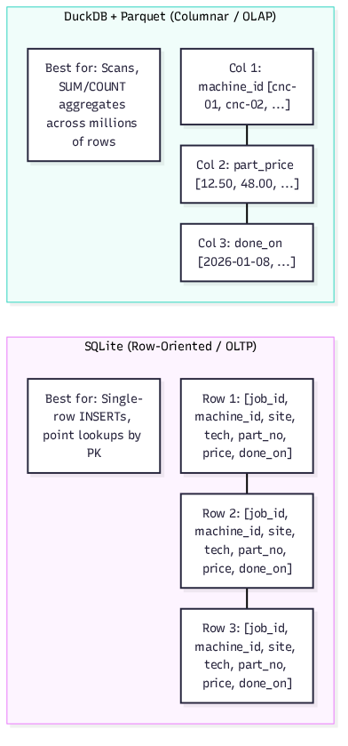
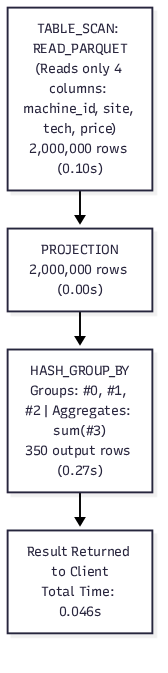
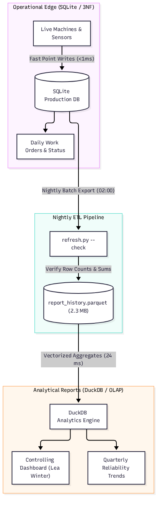

# Module 6a — The Analytical Engine (DuckDB)

**Portfolio of:** Trainn  
**Class:** HSBI Database Class  

In this module, I investigated why operational databases struggle with historical reporting and how decoupling analytical queries to a columnar engine (**DuckDB + Parquet**) solves the problem. Using a 2,000,000-row maintenance history spanning 2.5 years, I benchmarked read aggregations, execution plans, storage compression, and write/lookup boundary limits.

---

## Architecture: Row-Oriented vs. Columnar



- **SQLite (Row-Oriented / OLTP):** Stores records row-by-row on B-tree pages. Ideal for point writes, transactional safety, and looking up single records by primary key (`WHERE id = ?`). But aggregating across millions of rows requires loading every single unused column into RAM.
- **DuckDB + Parquet (Columnar / OLAP):** Stores values grouped by column. Aggregating part prices across machines reads only the specific column slices needed, skipping unused columns completely. Vectorized SIMD execution processes chunks of 2,048 rows simultaneously.

---

## 1. Building the 2,000,000-Row History

I created [Module06a/prepare.py](prepare.py) to stretch the 90-day report from Module 5 across 10 quarters (2.5 years of factory operations):

```sh
$ uv run python Module06a/prepare.py
history rows: 2000000
csv bytes   : 10805002
```

- **Row count:** Exactly 2,000,000 rows in `history.db`.
- **CSV export:** Exported with explicit `utf-8` encoding to prevent encoding corruption on German characters (`Gütersloh`).

---

## 2. Converting to Parquet & Verifying Parity

I wrote [Module06a/to_parquet.py](to_parquet.py) to convert the dataset into columnar Parquet format using DuckDB and verified that both engines matched on row counts and price totals:

```sh
$ uv run python Module06a/to_parquet.py
SQLite rows : 2,000,000 | SQLite sum : 21,000,000.00 | Size : 112.69 MB
Parquet rows: 2,000,000 | Parquet sum: 21,000,000.00 | Size : 2.32 MB
Verification: PERFECT MATCH between SQLite and Parquet!
```

- **Data Parity:** The row count (2,000,000) and sum of parts costs (€21,000,000.00) match to the penny.
- **Storage Win:** Parquet dictionary encoding compressed the database from **112.69 MB** down to **2.32 MB** (a **48.5× storage reduction**).

---

## 3. The Race: SQLite vs. DuckDB

I created [Module06a/race.py](race.py) to run 5 interleaved runs per engine (after a discarded warm-up run) and reported the medians:

| Query Type | SQLite Median (ms) | SQLite Spread (ms) | DuckDB Median (ms) | DuckDB Spread (ms) | Speedup Factor |
|---|---|---|---|---|---|
| **Dashboard Query** (Machine/Site Aggregation) | **2,751.0 ms** | 2731.5 - 3611.8 | **24.8 ms** | 21.8 - 25.6 | **110.7× faster** |
| **Monthly Query** (Date Truncated Report) | **3,193.1 ms** | 3188.3 - 3244.4 | **21.9 ms** | 20.4 - 25.5 | **145.7× faster** |

> **Classmate Note (The `strftime` Trap):** Following Trevor Kiio's observation, SQLite requires `strftime('%Y-%m', done_on)` (format first, then date). Calling it in reverse does not throw an error in SQLite, but silently fails to group months properly. Ensuring dialect-correct syntax was required to get identical result sets.

---

## 4. Execution Plan Analysis

I analyzed the physical execution plans using [Module06a/plan.py](plan.py):



### DuckDB `EXPLAIN ANALYZE`:
```text
TABLE_SCAN (READ_PARQUET)
  Function: READ_PARQUET
  Projections: machine_id, site, technician, part_price (4 columns, not 7!)
  2,000,000 rows (0.10s)
PROJECTION
  2,000,000 rows (0.00s)
HASH_GROUP_BY
  Groups: #0, #1, #2 | Aggregates: sum(#3)
  350 output rows (0.27s)
```

### SQLite `EXPLAIN QUERY PLAN`:
```text
SCAN report_history
USE TEMP B-TREE FOR GROUP BY
```

### Why DuckDB is 110× Faster:
1. **Column Projection:** DuckDB reads only 4 columns from Parquet and never touches the remaining 3 columns. SQLite scans all 7 columns off disk.
2. **Hash Grouping vs. B-Tree Sort:** DuckDB builds an in-memory hash table (`HASH_GROUP_BY`) using vectorized CPU registers. SQLite sorts all 2,000,000 rows into a temporary B-tree (`USE TEMP B-TREE FOR GROUP BY`), which takes 2.7+ seconds.

---

## 5. The Boundary: Where DuckDB is the Wrong Engine

I wrote [Module06a/boundary.py](boundary.py) to measure 1,000 single-row inserts and point lookups:

| Operation (1,000 executions) | SQLite (ms) | DuckDB (ms) | Winner |
|---|---|---|---|
| **Single-Row INSERTs** | **2.06 ms** | 1,482.91 ms | **SQLite is 721.6× faster** |
| **Single-Row Point SELECTs** | **2.12 ms** | 797.88 ms | **SQLite is 376.7× faster** |
| **Batch `executemany` INSERTs** | **0.96 ms** | 1,083.91 ms | **SQLite is 1,134.7× faster** |

**The Number & The Boundary:**  
For Kortmann's plant, **DuckDB is the wrong engine when processing individual writes or point lookups**. DuckDB pays a heavy per-statement query compilation and transaction boundary cost. Single-row writes must remain in SQLite.

---

## 6. Decision Memo & Refresh Pipeline



I documented the architectural recommendation in [Module06a/memo.md](memo.md) addressed to Lea Winter (Controlling) and Yasmin Kaya (Operations):
- **Live Writes:** Real-time sensor logs, repairs, and machine updates stay strictly in **SQLite (3NF)**.
- **Analytics:** Multi-quarter reports query **Parquet** snapshots via **DuckDB**.

### Automated Refresh Pipeline:
I implemented the automated ETL script [Module06a/refresh.py](refresh.py) with `--check` data verification:

```sh
$ uv run python Module06a/refresh.py --check
[CHECK] SQLite : rows=2,000,000, sum=21,000,000.00
[CHECK] Parquet: rows=2,000,000, sum=21,000,000.00
[PASS] Integrity checks verified: exact match.
Refresh complete: rows=2,000,000 | size=2.47 MB | sha256=9d368e1365ea | time=2106.5 ms
```
The script attaches the SQLite database directly, exports the Parquet file in ~2.1 seconds, and validates row counts and financial totals before publishing.

---

## 7. Compression Comparison (Homework)

I compared standard Snappy compression against Zstandard using [Module06a/compare_compression.py](compare_compression.py):

| Compression Codec | File Size | Size Ratio | Warm Query Time |
|---|---|---|---|
| **Snappy** (Default) | 2.32 MB | 1.0× | 32.5 ms |
| **Zstandard** (`zstd`) | **1.37 MB** | **1.70× smaller** | **29.1 ms** |

**Conclusion:** Zstandard reduces the file size by an extra 41% while maintaining or slightly improving query speed due to reduced disk I/O.

---

## Reflection
My thoughts, notes on classmate collaboration with Trevor Kiio and Trevor Fidel, and takeaways for this module are documented in:  
**[Reflection 6a](/Reflections/ref06a.md)**
