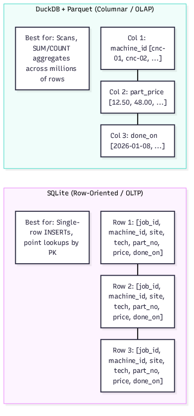
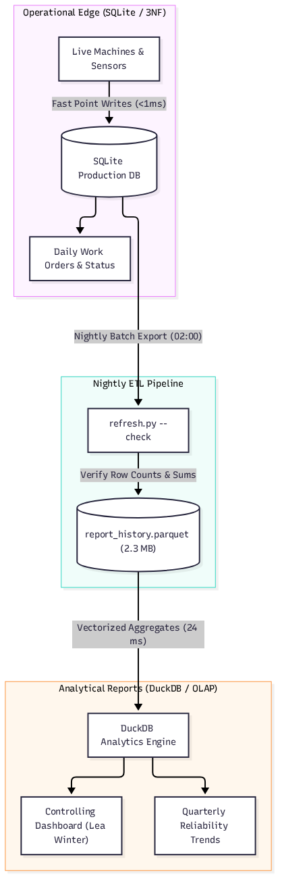
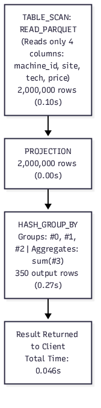

# Pictures for Module 6a

Diagrams illustrating the architectural differences between OLTP (SQLite) and OLAP (DuckDB + Parquet).

---

### 1. `oltp-vs-olap.png` — Row-Oriented vs. Columnar Storage
* **Context:** Pod Study (The Architecture Gap).
* **Description:** Compares SQLite's row-based B-tree storage with DuckDB's column-oriented Parquet storage, showing why columnar engines only read the projected columns during aggregations.

---

### 2. `sqlite-to-parquet-pipeline.png` — Analytical Export Pipeline
* **Context:** Task 6 (Decision Memo) & Task 7 (`refresh.py`).
* **Description:** Architecture diagram showing operational point writes staying inside SQLite, while historical analytics are exported to Parquet for DuckDB processing.

---

### 3. `duckdb-hash-groupby-plan.png` — DuckDB Physical Execution Plan
* **Context:** Task 4 (Query Profiling with `EXPLAIN ANALYZE`).
* **Description:** Execution tree demonstrating DuckDB's vectorized `READ_PARQUET` scan filtering 2,000,000 rows into a high-speed `HASH_GROUP_BY` operator.

