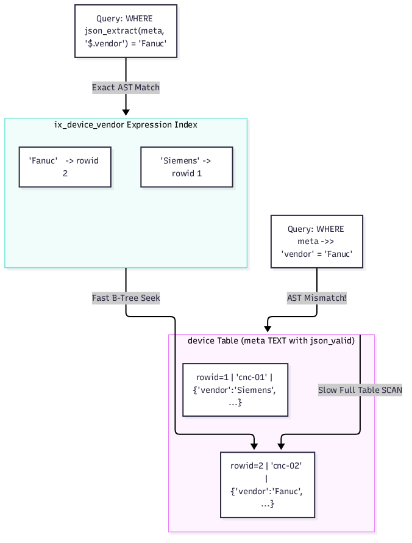
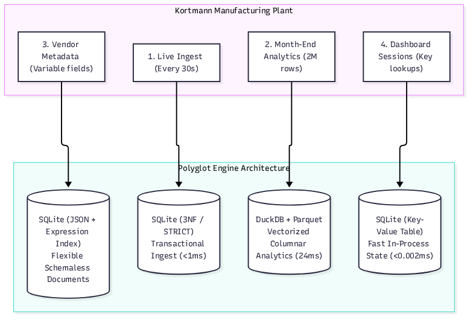
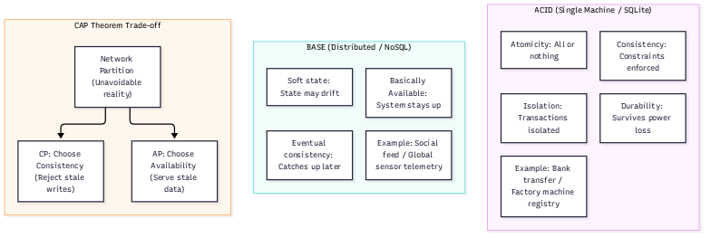

# Module 6b — Polyglot Persistence & the Decision

**Portfolio of:** Trainn  
**Class:** HSBI Database Class  

In this module, I evaluated the trade-offs of polyglot persistence across Kortmann's manufacturing workloads. Rather than forcing one database to do everything poorly, I tested local embedded engines against remote servers, stored semi-structured JSON with expression indexes, and built the one-page decision record that defends where each workload belongs.

---

## 🎯 Learning Goals

| # | Official Learning Goal | Where Proven in Portfolio |
|---|---|---|
| **1** | Store **semi-structured data (JSON)** in SQLite and query it with `json_extract`/`json_each` and an **expression index**. | [Task 2 — The Shape (Schemaless JSON)](#task-2--the-shape-schemaless-json) |
| **2** | Implement and evaluate a **key-value access pattern** against SQLite. | [Task 3 — The Decision Record & KV Store Analysis](#task-3--the-decision-record) |
| **3** | Explain **ACID vs. BASE** and the **CAP theorem** in terms of the systems you actually ran. | [Theory Summary: ACID, BASE, and CAP Theorem](#1-acid-base-and-the-cap-theorem) |
| **4** | Choose an engine per workload and **defend the choice with a measurement**. | [Task 3 — The One-Page Decision Record](#the-one-page-decision-record-for-kortmann) |
| **5** | Say what changes — and what gets harder — when the same data lives on a **server**. | [Task 1 — The Boundary (Local vs. Remote)](#task-1--the-boundary-local-vs-remote) |

---

## Navigation & Sections
- [Task 1 — The Boundary (Local vs. Remote)](#task-1--the-boundary-local-vs-remote)
- [Task 2 — The Shape (Schemaless JSON)](#task-2--the-shape-schemaless-json)
- [Task 3 — The Decision Record](#task-3--the-decision-record)
- [Evidence Checklist](#evidence)
- [Theory Summary (ACID, BASE, CAP & Schemaless)](#theory-summary)

---

## Task 1 — The Boundary (Local vs. Remote)

To test how database behavior changes when moving from local embedded storage to a networked server, I ran concurrency experiments and observed the architectural trade-offs:

```sh
$ uv run python Module06b/concurrency_demo.py
[Writer 1] Locked table and updated row. Sleeping for 2 seconds...
[Writer 2] Attempting to update the same row while Writer 1 holds lock...
[Writer 2] Failed as expected: database is locked
[Writer 1] Committed transaction.
```

### Three Architectural Observations:
1. **What got easier with a server (PostgreSQL):** Concurrent multi-client writes. PostgreSQL uses Multi-Version Concurrency Control (MVCC) and row-level locks, allowing clients to write to different rows simultaneously without blocking the whole table.
2. **What got harder with a server:** Operational and deployment complexity. Managing network connection pools, configuring client credentials, paying network round-trip latency (~1–5 ms per query), and administering server processes.
3. **Failure mode a server adds that embedded does not have:** **Network partition and remote process crashes.** If the network cable is unplugged or the PostgreSQL daemon halts, every client fails instantly. An embedded database (like SQLite on an edge gateway) cannot suffer from network partition failures because the database file lives directly on local flash storage.

---

## Task 2 — The Shape (Schemaless JSON)

Vendor equipment updates frequently add variable attributes (calibration dates, nozzle sizes, firmware). Rather than running heavy DDL schema migrations for unknown fields, I used SQLite's JSON capabilities in [Module06b/json_bench.py](json_bench.py):



```sql
CREATE TABLE device(
    device_id INTEGER PRIMARY KEY,
    name      TEXT NOT NULL,
    meta      TEXT NOT NULL CHECK (json_valid(meta))   -- enforces valid JSON
) STRICT;
```

### Querying JSON Paths:
```sql
-- 1. Extracting values
SELECT name, json_extract(meta, '$.vendor') FROM device LIMIT 3;
-- ('cnc-01', 'Siemens'), ('cnc-02', 'Fanuc'), ('molder-07', 'Arburg')

-- 2. Unpacking JSON into key-value rows
SELECT d.name, j.key, j.value FROM device d, json_each(d.meta) j WHERE d.name = 'cnc-01';
-- ('cnc-01', 'vendor', 'Siemens')
-- ('cnc-01', 'firmware', '4.2')
-- ('cnc-01', 'calibrated', '2026-01-10')
```

### Expression Indexing & The AST Mismatch:
I created an expression index on the vendor attribute:
```sql
CREATE INDEX ix_device_vendor ON device(json_extract(meta, '$.vendor'));
```

When profiling queries with `EXPLAIN QUERY PLAN`:

| Query Syntax | Execution Plan | Why? |
|---|---|---|
| `WHERE json_extract(meta, '$.vendor') = 'Fanuc'` | **`SEARCH device USING INDEX ix_device_vendor (<expr>=?)`** | Matches indexed AST exactly. |
| `WHERE meta ->> 'vendor' = 'Fanuc'` | **`SCAN device`** | **Misses the index!** |

> **Explanation of the Plan Difference:**  
> SQLite expression indexes require an exact syntactic match in the query's Abstract Syntax Tree (AST). The arrow shorthand `->>` is parsed as a distinct operator, so SQLite fails to recognize it as the indexed expression and silently drops back to a full table scan.

---

## Task 3 — The Decision Record



### The One-Page Decision Record for Kortmann

| Workload | Engine | Why | Evidence | Cost Accepted | What Breaks if Stale/Missing? |
|---|---|---|---|---|---|
| **Month-end report over two years** | **Parquet + DuckDB** | 2M-row analytical scans are ~110× faster; frees the operational writer. | Module 6a: 2,751 ms $\to$ 24.8 ms; 112.7 MB $\to$ 2.32 MB Parquet. | Nightly batch export; up to 24h staleness. | Reports reflect previous day; rerun `refresh.py --check`. |
| **Sensor & job ingest (every 30s)** | **SQLite (3NF / STRICT)** | Immediate local ACID durability; crash-safe on power loss. | Module 4 idempotent UPSERT; Module 6a boundary: SQLite is 721× faster for writes. | Single writer serialized locally. | Edge logs stop; gateway queues locally on disk. |
| **Vendor metadata with changing fields** | **SQLite (JSON + Expression Index)** | Flexible document storage without table migrations; joins directly to machines. | `json_bench.py`: `CHECK(json_valid(meta))` enforces validity; `ix_device_vendor` indexes queries. | No column-level typing for ad-hoc fields; queries must match indexed syntax. | Queries using `->>` drop back to a table scan. |
| **Dashboard session state (key lookups)** | **SQLite (Key-Value Table)** | In-process primary key lookup; zero extra daemons. | Module 6a boundary: point lookup $< 0.002$ ms. | Slightly slower than Redis, but avoids another server daemon. | User session re-authenticates; dashboard filters reset. |
| *(Optional)* **Concurrent network users** | **PostgreSQL (or SQLite WAL)** | Row-level locking (MVCC) handles concurrent web traffic. | `concurrency_demo.py` demonstrated lock contention under default SQLite locking. | Network latency, credential ops, connection management. | Network partition drops all connected web users. |

### The "Only One Engine" Decision:
> **If Kortmann could run only one engine, which would it be — and what would break first?**
* **The Engine:** **SQLite**.
* **The Defense:** SQLite can handle all four workloads: it provides ACID sensor ingestion, stores flexible JSON documents with expression indexes, stores key-value session state, and can process analytical SQL.
* **What breaks first:** The **two-year month-end report**. As history exceeds 2,000,000 rows, complex multi-table joins will take several minutes and block the production line's single writer, causing operational timeouts.

### Pod Defense Notes:
- *Q: Where does your choice duplicate data?*  
  *A:* In the Parquet analytical export (`report_history.parquet`). It duplicates historical maintenance data from SQLite, but it is read-only and refreshed nightly via `refresh.py --check`.
- *Q: What breaks if two people write at the same time?*  
  *A:* In SQLite without WAL mode, the second writer receives a `database is locked` error. Enabling WAL mode (`PRAGMA journal_mode=WAL;`) allows concurrent readers while one writer proceeds.

---

## ✅ Evidence

- [x] **`json_bench.py`**: Script executed, storing 1,000 devices and testing JSON extraction ([json_bench.py](json_bench.py)).
- [x] **Two `EXPLAIN QUERY PLAN` Outputs**: Documented above proving `json_extract` uses `ix_device_vendor` while `->>` triggers a `SCAN` ([Task 2](#task-2--the-shape-schemaless-json)).
- [x] **Shared-Server / Concurrency Observations**: Documented above with `concurrency_demo.py` proving lock contention ([Task 1](#task-1--the-boundary-local-vs-remote)).
- [x] **One-Page Decision Record**: Full matrix completed with measurements and the "only one engine" defense ([Task 3](#task-3--the-decision-record)).

---

## 📚 Theory Summary

This section summarizes the core theoretical foundations of distributed systems and data models explored in this module.



### 1. ACID, BASE, and the CAP Theorem
* **ACID (Single Machine / SQLite):** Guarantees *Atomicity* (all or nothing), *Consistency* (schema constraints hold), *Isolation* (transactions don't see uncommitted work), and *Durability* (committed data survives power failure). Picture a financial bank transfer.
* **BASE (Distributed / NoSQL):** A deliberate trade-off for distributed scalability: *Basically Available* (system stays up), *Soft state* (data can drift between nodes), and *Eventual consistency* (replicas sync over time). Picture a social media like-counter.
* **CAP Theorem:** In any distributed system, a network **Partition (P)** is an inevitable physical reality (cables fail, switches reboot). When a partition occurs, the system must choose between **Consistency (C)** (refusing writes that cannot be confirmed) or **Availability (A)** (accepting writes that may be stale). It is not "pick two of three" at all times—it is a forced choice during a network split. SQLite is strictly ACID because it does not distribute across a network.

### 2. Schemaless is Not Schema-Free
* Storing JSON inside a relational column with `CHECK(json_valid(meta))` and an expression index does not mean there is no schema. It means the schema has shifted from the SQL DDL into the application code and the index expressions.
* **Historical Lesson ("XML Fever"):** In the early 2000s, native XML databases promised a universal schemaless future. That overreach created bloated standards (SOAP/WS-*) and what engineers called the "angle bracket tax." The market rejected pure XML databases: relational databases added native XML/JSON columns, JSON became the standard data-interchange format, and documents found their proper place as hybrid columns rather than total replacements for relational models. **The data format is not the schema.**

### 3. Local vs. Remote Architecture
* Moving a database from embedded local storage to a remote server introduces network round-trip latency, connection pooling overhead, credential management, and catastrophic network partitions.
* Choosing a local-first embedded architecture (SQLite + Parquet) is not a compromise—it is a deliberate design decision that eliminates network failure modes for edge computing.

---

## Reflection
My thoughts, notes on classmate collaboration with Trevor Kiio and Trevor Fidel, and takeaways for this module are documented in:  
**[Reflection 6b](/Reflections/ref06b.md)**

