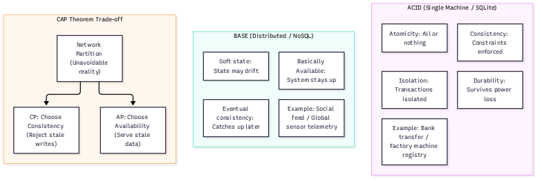
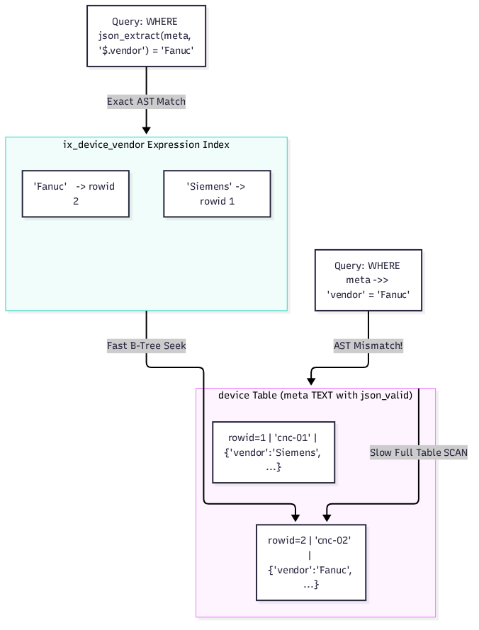
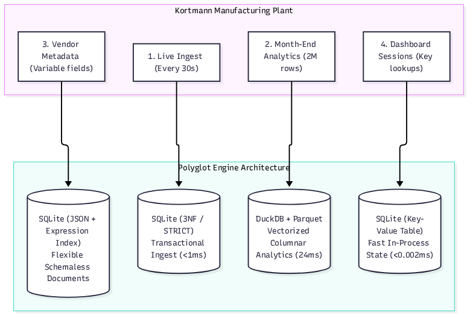

# Pictures for Module 6b

Diagrams documenting polyglot persistence, expression indexes, and distributed architecture trade-offs.

---

### 1. `acid-vs-base-cap.png` — ACID vs. BASE and the CAP Theorem
* **Context:** [Theory Summary](#theory-summary-acid-base-and-the-cap-theorem).
* **Description:** Breaks down single-machine ACID guarantees against distributed BASE architectures and the unavoidable CAP partition trade-off.

---

### 2. `json-expression-index.png` — SQLite Expression Index Matching
* **Context:** [Task 2 — The Shape (Schemaless JSON)](#task-2--the-shape-schemaless-json).
* **Description:** Visualizes why `json_extract(meta, '$.vendor')` utilizes the B-tree index, whereas the arrow operator `meta ->> 'vendor'` triggers a full table scan due to AST mismatch.

---

### 3. `kortmann-workload-decision.png` — Kortmann's Engine Architecture
* **Context:** [Task 3 — The Decision Record](#task-3--the-decision-record).
* **Description:** Shows how the four plant workloads are assigned to specialized database shapes.

